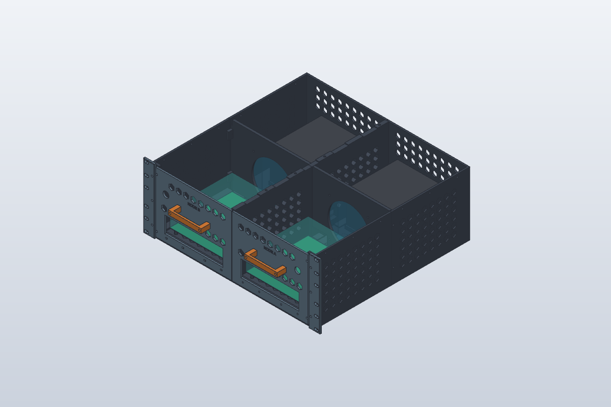
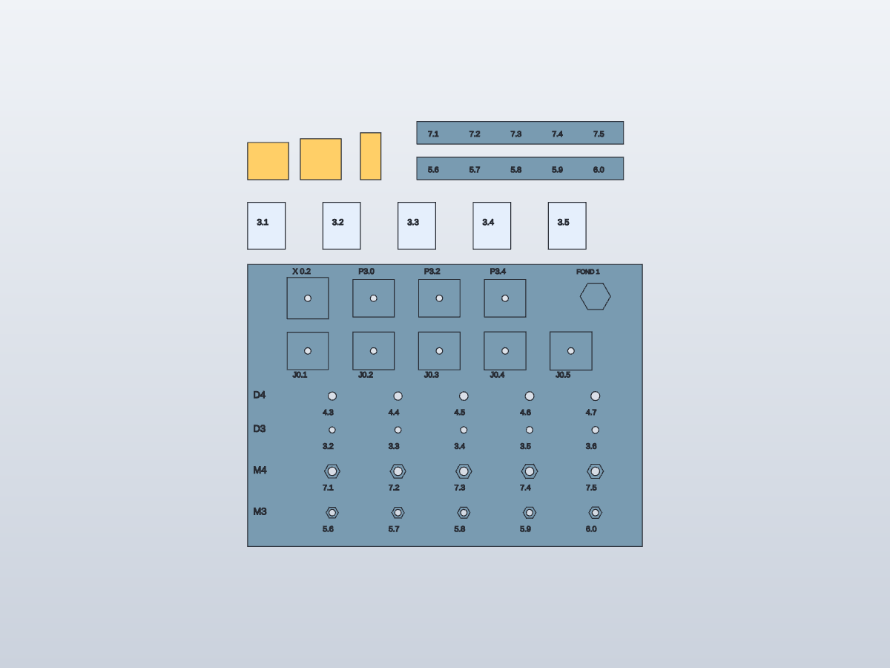

# Rack Blade 19 pouces · Notice d’impression et de montage

**Version 1 — 25 octobre 2026 · Modèle SolidCraft R3 · Prototype**

Deux volets : préparer et imprimer les pièces, puis assembler le rack sur établi. Cette notice décrit les fichiers actuels et propose un ordre de travail. Elle ne constitue pas encore un bon à fabriquer : les résultats de la planche de tolérances et plusieurs interfaces matérielles restent à intégrer.

*Les couleurs des vues servent uniquement au repérage. Toutes les pièces peuvent être imprimées en PETG noir. Les volumes transparents représentent des enveloppes simplifiées du matériel.*

## Architecture — se repérer avant de commencer

Le châssis mesure **446 × 424 × 176,5 mm** ; les oreilles portent la largeur à 482,6 mm. Deux tiroirs sortent par l’avant. Chaque baie accueille une Turing Pi 2.5 avec quatre RK1 ventilés et une alimentation à l’arrière.

Le trajet prévu est : **façade → cartes et RK1 → ventilateurs centraux → alimentations → arrière**. Les hexagones des côtés, du dessous et des capots sont des poches d’allègement avec un fond continu de 1 mm. Ne pas les déboucher. Les grilles avant et arrière restent traversantes.

AV = avant, AR = arrière ; D et G sont les repères du modèle. Conserver ces noms sur les pièces : ne pas créer la gauche en retournant ou en mettant en miroir la droite, notamment pour les tiroirs et les interfaces de carte.

## Composants — inventaire à cocher

| Famille | Fichiers / repères | Quantité | Rôle |
|---|---|---:|---|
| Quadrants | Q-AV-D, Q-AV-G, Q-AR-D, Q-AR-G | 4 | Fond et parois extérieures |
| Cloisons | CL-AV, CL-AR | 2 | Séparation centrale |
| Parois ventilateurs | FW-D, FW-G | 2 | Support des ventilateurs centraux |
| Tiroirs | BT-D, BT-G | 2 | Support des cartes et guidage |
| Façades | BF-D, BF-G | 2 | Connectique, bouton, fermeture avant |
| Poignées | HANDLE-D, HANDLE-G | 2 | Extraction des tiroirs |
| Oreilles | EAR-D, EAR-G | 2 | Fixation avant dans la baie |
| Capots | TOP-AV-D/G, TOP-AR-D/G | 4 | Fermeture supérieure |
| Biscuits | BIS | 20 | 16 au montage, 4 en réserve |
| Biscuits centraux | BIS-X | 2 | Jonctions centrales |

Soit **20 grandes pièces et accessoires distincts, plus 22 biscuits imprimés** ; 18 biscuits sont prévus dans l’assemblage. Le lot de biscuits remplace l’impression séparée de BIS et BIS-X : ne pas compter les deux méthodes en double.

Préparer un pied à coulisse, les vrais écrous et vis, des clés adaptées, un outil d’ébavurage, des rondelles, des joints fins compressibles et les sangles d’alimentation. Les longueurs de vis sont indicatives tant que l’engagement réel n’a pas été contrôlé.

## Volet 1 — impression des pièces

### 1. Exploiter la planche de tolérances

La planche a été envoyée avec **X1 Carbon, buse 0,4 mm, PETG HF noir A3, plaque lisse, couches de 0,16 mm et première couche de 0,20 mm**. Son tranchage estime 140,13 g et 3 h 58. Elle utilise deux parois, 15 % de remplissage et aucun support ; ces valeurs décrivent l’éprouvette, pas une qualification structurelle du rack.

Après refroidissement, retirer seulement les fils et bavures libres. Ne pas limer les surfaces d’ajustement avant le relevé.

| Essai | Procédure | Résultat recherché |
|---|---|---|
| Écrous M3 / M4 | Commencer par le plus grand logement ; comparer les poches à plat et verticales | Insertion sans fissure, écrou immobilisé en rotation |
| Trous D3 / D4 | Essayer les vis réellement utilisées | Passage libre sans jeu inutile |
| Biscuit J | Commencer par J0.5 puis diminuer | Emboîtement manuel, ferme et démontable |
| Profondeur P | Comparer P3.0, P3.2 et P3.4 | Biscuit sans dépassement gênant la jonction |
| Biscuit carré X | Tester le carré dans X0.2 | Mise en place et retrait sans arrachement |
| Rainures 3.1–3.5 | Engager la languette par le bout, de 3.5 vers 3.1 | Coulissement régulier sur toute l’éprouvette |
| FOND 1 | Regarder à contre-jour et inspecter la surface | Peau continue, sans trou ni défaut de pontage |

**J0.2 signifie 0,2 mm de jeu total**, soit 0,1 mm par côté si le biscuit est centré. Les inscriptions 3.1 à 3.5 indiquent la hauteur de rainure, pas le jeu. Reporter les choix dans [resultats.csv](Tolerances/resultats.csv). La notice sera révisée avec ces valeurs ; le modèle du rack n’est pas encore adapté à ces résultats.

### 2. Choisir les bons fichiers

Utiliser les fichiers du dossier [exports/3mf](exports/3mf/). Ils contiennent des géométries orientées, **sans réglages d’impression Bambu**. Ne pas imprimer les exports bruts conservés dans `verification/original-3mf/` ni les archives R1/R2.

Importer à **100 %**, en millimètres, conserver l’orientation fournie comme point de départ et affecter tous les objets au même PETG noir. Ne pas utiliser une mise à l’échelle globale pour corriger les logements d’écrous : elle modifierait aussi les dimensions du rack.

Conserver la buse, le matériau, la hauteur de couche et les compensations des essais : XY trous = 0, XY contours = 0, pied d’éléphant = 0,15 mm pour la planche actuelle. Tout changement de profil affectant les ajustements impose de retester un échantillon.

### 3. Ordre proposé des impressions

| Lot | Pièces | Condition avant lancement |
|---|---|---|
| 0 — en cours | Planche de tolérances | Relever les valeurs après refroidissement |
| 1 — interfaces | Un BIS, un BIS-X et une portion représentative de rail si nécessaire | Reporter les jeux retenus ; confirmer les deux orientations de poches |
| 2 — première baie | Q-AV-D, CL-AV, BT-D, BF-D et HANDLE-D | Corriger les épaisseurs faibles et valider l’interface carte/façade |
| 3 — châssis complet | Les trois autres Q, CL-AR | Valider le guidage et l’équerrage du premier ensemble |
| 4 — équipements | FW-D/G, BT-G, BF-G, HANDLE-G, EAR-D/G | Valider fixation carte, ventilateurs et reprise de charge |
| 5 — fermeture | Les quatre TOP et le lot final de biscuits | Valider les jonctions, le câblage et le montage à blanc |

Le lot 1 avec une portion de rail est une étape proposée : aucun nouveau fichier de rail tronqué n’est fourni par cette notice. Une grande pièce par plateau simplifie le suivi ; regrouper seulement les petites pièces si leurs dégagements restent suffisants. Imprimer par couches.

### 4. Orientation et points à contrôler dans Bambu Studio

| Famille | Orientation fournie / point de départ | Vérifications prioritaires |
|---|---|---|
| Q | Fond vers le plateau, parois dressées ; environ 223 × 220 × 173,5 mm à l’avant | Ponts au-dessus des hexagones du dessous, peau de 1 mm, toits des rails et poches verticales |
| TOP | Capot retourné ; reliefs intérieurs vers le haut, hauteur totale 18 mm | Poches extérieures côté plateau : les fonds de 1 mm se forment au-dessus des alvéoles ; vérifier les ponts |
| CL | Orientation exportée, hauteur d’impression 40 mm | Appui réel des pieds, zones en porte-à-faux et accès aux écrous |
| FW | Orientation exportée, hauteur 21 mm | Alésage ventilateur, pieds et logements de fixation |
| BT | Orientation exportée, hauteur 19,6 mm | Nervures sous le fond, langues de guidage, peau sous les écrous et entretoises |
| BF / EAR | Orientation exportée, faibles épaisseurs | Première couche des ouvertures, logements d’écrous et surfaces d’appui |
| HANDLE | Orientation exportée, hauteur 12 mm | Pont sous la prise, accès aux vis et tenue des couches |
| BIS / BIS-X | À plat, épaisseur 3 mm | Pied d’éléphant, dimensions et absence de support |

**L’absence de supports n’est pas validée pour le rack complet.** Examiner l’aperçu couche par couche avant chaque pièce. Ne pas laisser un support inaccessible dans une rainure ou une poche d’écrou. Si un pont ne peut pas être imprimé proprement, revoir localement l’orientation ou la géométrie avant de lancer la pièce.

Les contrôles numériques attestent que les 23 fichiers 3MF sont fermés et contenus dans 240 × 240 × 210 mm ; ils ne prouvent ni l’imprimabilité de chaque surplomb ni la résistance. Ajouter une bordure seulement si nécessaire, en vérifiant qu’elle tient sur le plateau et qu’elle pourra être retirée sans toucher les ajustements.

Le nombre final de parois, le remplissage et les renforts des pièces porteuses restent à définir après correction des zones faibles. Une augmentation du remplissage ne remplace pas la matière manquante sous une poche d’écrou.

### 5. Contrôle à la sortie du plateau

Laisser refroidir, identifier la référence sous chaque pièce et vérifier : fond plan, absence de délamination, hexagones non percés, logements accessibles, biscuits affleurants et guidages libres. Conserver une fiche par plateau avec le profil utilisé, le poids et la durée réellement annoncés par le trancheur.

Ne pas utiliser les **4,25 kg à matériau plein** du rapport R3 comme quantité de bobines à commander : la consommation du rack complet n’a pas encore été tranchée.

## Volet 2 — montage sur établi

### 1. Présenter les pièces et préparer les écrous

Étaler les quadrants suivant leurs noms et la vue d’assemblage. Poser les cloisons, parois ventilateurs, tiroirs et capots à proximité. Tester chaque écrou dans son logement avant fermeture ; mettre en place ceux qui deviendront inaccessibles. Ne pas forcer un écrou en tirant fortement sur sa vis.

### 2. Assembler les quatre quadrants

Sur une surface plane, présenter les jonctions et leurs biscuits sans colle. Installer les biscuits correspondants, puis les vis de liaison avant/arrière. La nomenclature prévoit 16 BIS et 2 BIS-X dans l’ensemble châssis/capots : repérer chaque poche dans le modèle, sans supposer qu’ils vont tous dans le fond.

Approcher les vis sans bloquer. Contrôler que le fond reste à plat, que les jonctions ferment et que les diagonales sont cohérentes. Ne pas utiliser le serrage pour redresser une pièce gauchie.

### 3. Installer les cloisons centrales

Présenter CL-AV et CL-AR et fixer leurs pieds progressivement. Le modèle prévoit un dégagement d’environ 0,2 mm à l’assise de CL-AR : contrôler l’appui réel ; une cale peut être nécessaire. Vérifier le parallélisme des guidages centraux et extérieurs avant serrage final.

### 4. Tester les tiroirs vides

Engager BT-D et BT-G sans électronique, puis parcourir toute la course plusieurs fois. La simulation vérifie des positions jusqu’à 195 mm ; le retrait complet demande environ 201 mm. Ce résultat ne valide pas le frottement réel ni la rigidité sous charge.

Monter provisoirement BF et HANDLE, vérifier l’affleurement des façades et le verrouillage. Si le tiroir coince, localiser la zone avant de retoucher : bavure, pied d’éléphant, défaut de parallélisme ou jeu insuffisant. Ne pas poncer au hasard toute la longueur.

### 5. Monter les parois et ventilateurs

Fixer FW-D et FW-G, puis les deux ventilateurs de 120 × 120 × 25 mm. Orienter leur flèche de débit **vers l’arrière**. Vérifier qu’aucune pale ni aucun câble ne touche une pièce et que les écrous restent accessibles.

### 6. Présenter les cartes et alimentations hors tension

Contrôler sur les vraies Turing Pi 2.5 les quatre fixations, l’alignement des ports de façade, la place des SSD et la hauteur de chaque ensemble RK1 + dissipateur + ventilateur. Vérifier que les vis n’atteignent pas un composant ou une piste sous le PCB.

Présenter les alimentations dans leurs berceaux avec les sangles. **Les huit trous de fixation UNC 6-32 ne sont pas encore modélisés** : relever leurs positions avant de finaliser cette fixation. Les sangles et berceaux ne remplacent pas une validation de maintien. Ne pas ouvrir les alimentations ; utiliser leurs fixations externes avec une longueur de vis adaptée.

### 7. Organiser le câblage et la sortie des tiroirs

Raccorder chaque alimentation à sa baie et guider les faisceaux hors des ventilateurs et rails. Prévoir au moins 250 mm de réserve mobile selon le cahier des charges, en plus du parcours fixe ; vérifier la longueur réelle sur le montage. Une rallonge ATX peut être nécessaire.

Faire le premier essai de sortie **hors tension** : sortir lentement chaque tiroir, accompagner les câbles et s’arrêter avant toute traction sur un connecteur. Ce prototype ne définit pas de procédure d’extraction à chaud.

### 8. Fermer le circuit d’air

Poser des joints fins aux coutures et aux capots sans gêner les rails. Obturer les passages inutilisés, conserver les admissions avant, les rejets arrière et l’espace au-dessus des entrées des alimentations. Monter les quatre TOP et leurs biscuits, puis approcher et serrer progressivement les fixations.

La peau de 1 mm ferme les alvéoles ; l’étanchéité des coutures dépend du montage et des joints. Les joints doivent comprimer sans déformer le capot ni soulever les coins.

### 9. Installer dans la baie après validation sur établi

Monter EAR-D et EAR-G et utiliser des vis/écrous-cages adaptés aux montants. **La charge admissible des oreilles PETG n’est pas établie** : prévoir un appui sous le châssis pour les essais dans le rack. Les deux cornières blanches et leurs attaches ne font pas partie de cette version de la notice ; leur conception a été mise de côté.

### Visserie à préparer par étape

| Assemblage | Prévision actuelle |
|---|---|
| Jonctions avant/arrière | 4 vis M4 × 16 + écrous |
| Pieds de cloisons | 16 vis M4 × 12 + écrous |
| Parois ventilateurs | 4 vis M4 × 16 + écrous |
| Ventilateurs | 8 vis M4 × 35 + écrous |
| Cartes | 8 vis M3 × 22 + écrous |
| Façades / tiroirs | 8 vis M3 × 12 + écrous |
| Poignées | 4 vis M4 × 35 + écrous |
| Oreilles / cadre | 6 vis M4 × 12 + écrous |
| Verrouillage des tiroirs | 4 vis moletées M4 × 12, tête ≤ 8 mm, + écrous |
| Rabats de capot | 12 vis M4 × 12 + écrous |
| Capots / cloisons | 4 vis M4 × 16 + écrous et rondelles larges sur la couture |
| Alimentations | 8 vis UNC 6-32 ; longueur à confirmer |

Total indicatif : **16 écrous M3 et 62 écrous M4**, hors écrous-cages du rack. Vérifier engagement et dégagement de chaque vis avant serrage ; aucun couple de serrage n’est qualifié pour ce prototype. Inventaire détaillé dans [BOM.md](BOM.md).

## Comment tester — réception du montage

- [ ] Chaque pièce est identifiée et sans fissure ; les fonds hexagonaux restent fermés.
- [ ] Châssis posé à plat, cloisons alignées, tiroirs mobiles et verrouillables.
- [ ] Cartes et alimentations maintenues ; aucune vis ne touche l’électronique.
- [ ] Câbles libres sur la course, retenus hors des ventilateurs.
- [ ] Capots fermés ; aspiration en façade et rejet arrière vérifiés, fuites aux coutures recherchées.
- [ ] Essai thermique progressif : une baie d’abord, puis les deux, en relevant températures, charge et ventilation.
- [ ] Absence de déformation, desserrage ou coincement après refroidissement.

Les seuils thermiques acceptables sont à prendre dans les spécifications des équipements ; cette notice ne fixe pas de valeur arbitraire. Le refroidissement de huit RK1 et de deux alimentations n’est pas encore validé physiquement.

## Prochaines améliorations — éléments à figer en V2

1. Reporter les résultats de la planche dans les jeux d’écrous, biscuits et rails, en distinguant les orientations d’impression.
2. Renforcer les zones signalées en R1 : nervures de tiroir de 1,6 mm et fond résiduel de seulement 0,4 mm sous certaines poches M3 ; revoir les autres logements faibles.
3. Confirmer les trous PSU, le plan carte/I/O, les SSD et l’accès BMC RESET sur matériel réel.
4. Définir les chanfreins, toits de rainure, supports localisés et profils de chaque famille ; trancher pour obtenir temps et masses fiables.
5. Ajouter des vues éclatées avec les positions numérotées de chaque biscuit et vis, puis qualifier la reprise de charge dans la baie.

**Sources de cette première version :** [README](README.md), [rapport R3](RAPPORT_VERIFICATION.md), [réserves R1](RAPPORT_VERIFICATION_R1.md), [nomenclature](BOM.md), [notice de tolérances](Tolerances/README.md), exports orientés et réglages sauvegardés dans [le projet Bambu noir](Tolerances/Rack_Tolerance_PETG_Noir_X1C.3mf). Aucun modèle CAO ni travail d’impression supplémentaire n’est lancé par cette notice.
