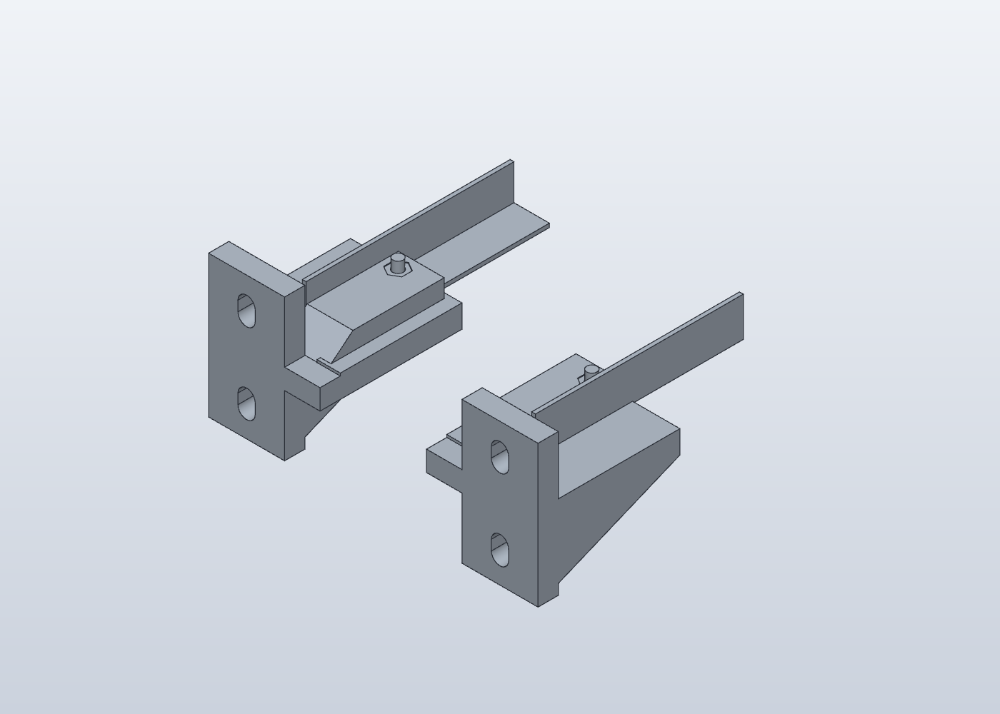
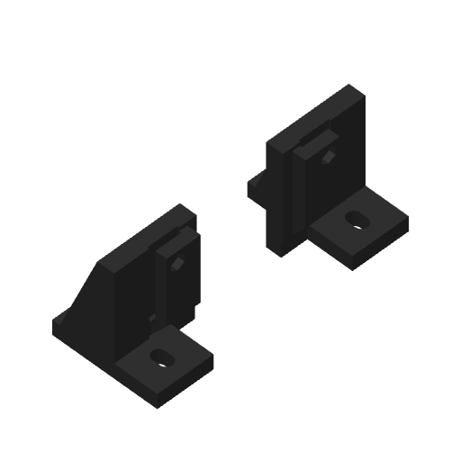

# R2 — supports arrière à gorge et verrou M4

Les deux supports arrière reçoivent une gorge fermée au-dessus de l'aile horizontale de la cornière. Le rail s'insère depuis l'intérieur de la baie jusqu'à la butée. Une **vis M4 introduite par dessous traverse le support, le métal et le toit de la gorge ; l'écrou se loge au-dessus**. Les deux supports avant restent identiques à R1. Les huit fixations M6 sur les montants sont conservées.

## Fichiers à utiliser

- `Supports_Rails_L_PETG_R2.solidcraft` : quatre pièces réelles, AV-A, AV-B, AR-A, AR-B.
- `Plateau_2_arriere_M4_R2_PETG_noir.3mf` : **uniquement les deux supports arrière modifiés**. À utiliser si les pièces avant sont déjà imprimées.
- `Plateau_4_supports_R2_PETG_noir.3mf` : jeu complet, un exemplaire de chaque pièce. Ne pas imprimer les deux plateaux : leurs pièces arrière font doublon.
- `Montage_berceaux_reference.solidcraft` et `exports/Montage_berceaux_reference.step` : démonstration. Les tronçons de rail, vis et écrous `REF-*` sont schématiques et exclus des plateaux d'impression.

## Montage et sens des pièces

Vu depuis l'avant de la baie : AV-A à gauche et AV-B à droite. À l'arrière, AR-B va à gauche et AR-A à droite, tournés de 180° autour de la verticale pour diriger leurs gorges vers l'intérieur de la baie.

Les platines sont derrière les montants avant et devant les montants arrière. Reprendre le [montage M6 de R1](../README.md) : vis depuis l'intérieur, écrou métallique de l'autre côté, rondelles et longueur adaptées à l'empilage. Serrer ces M6 avant d'insérer les rails.

1. Présenter les supports, vérifier les hauteurs et la place du châssis, puis couper les deux cornières à longueur entre les butées. Les butées restent à 18 mm des faces intérieures des montants.
2. Ébavurer les cornières, puis insérer chaque extrémité arrière dans sa gorge, aile verticale vers l'extérieur de la baie. L'aile horizontale glisse sous le toit.
3. Pointer le perçage en présentant le rail dans son support. Son centre nominal se trouve **à 30 mm de l'extrémité coupée**, et à **7,75 mm du bord extérieur de l'aile horizontale de 15,5 mm**. La présentation réelle prévaut, notamment si la cornière possède déjà un trou oblong à cet endroit.
4. Retirer la cornière pour la percer **à 4,3 mm**, hors du support plastique. Ébavurer et nettoyer le métal avant de le réinsérer. Le trou doit être aligné avec les passages du support.
5. Insérer un écrou M4 dans le logement hexagonal supérieur. Introduire la vis M4 depuis le dessous ; le dégagement inférieur laisse passer la tête et l'outil. **Deux vis M4 × 20 mm et deux écrous M4** conviennent à l'empilage nominal sans rondelle ; adapter la longueur si une rondelle ou un écrou différent est utilisé. Vérifier l'engagement complet du filetage et l'absence de dépassement gênant.
6. Serrer modérément. La M4 sert de verrou traversant : ne pas chercher à supprimer le jeu de la gorge en écrasant le PETG. Vérifier que le rail ne peut plus sortir longitudinalement ni se soulever hors du support.

## Dimensions utiles

| Élément | Dimension nominale |
|---|---:|
| Cornière de référence | L 15,5 × 15,5 × 1,5 mm |
| Hauteur libre sous le toit | 2,1 mm pour l'aile de 1,5 mm |
| Largeur du logement de rail | 16,1 mm |
| Longueur du toit | 36 mm |
| Passage imprimé M4 | 4,3 mm |
| Logement d'écrou M4 | 7,2 mm entre plats, profondeur 3,4 mm |
| Dégagement sous la tête M4 | diamètre 10 mm |
| Dépassement du toit au-dessus de l'aile métallique | 6,6 mm, hors extrémité de vis |

Les dimensions 4,3 et 7,2 mm viennent des essais utilisateur. La gorge, la profondeur du logement et la compatibilité avec le métal peint restent à essayer. **Placer le verrouillage arrière hors de la surface où repose le châssis, ou vérifier qu'il dispose du dégagement nécessaire** : le toit et la vis dépassent du rail. La longueur de baie n'a pas été imposée et cette compatibilité ne peut pas être garantie par les photos.

## Impression

PETG HF noir, X1 Carbon, buse 0,4 mm, PEI lisse ; couches 0,20 mm, six parois, six couches pleines dessus/dessous, 40 % gyroid et bordure 5 mm.

Les supports arrière sont imprimés **platine M6 contre le plateau**. Leur rampe arrière et le prolongement sous la tablette permettent de construire la gorge dans ce sens sans supports internes à arracher. Les pièces avant conservent l'orientation latérale R1. Garder les orientations enregistrées dans les 3MF.

## Vérifications et limites

Le natif est contrôlé sans erreur de calcul ; chaque support est d'une seule coque. Les maillages sont fermés, avec contrôle du tranchage et des quantités. Le modèle de montage vérifie l'insertion nominale des rails percés et le passage des vis. Le moteur signale uniquement les contacts numériques sous les deux têtes de vis, épaisseur inférieure à 0,001 mm ; ils correspondent aux plans d'appui attendus, pas à un blocage du rail.

La tenue sous charge, le fluage du PETG et le serrage réel restent à qualifier sur la baie. Tester d'abord à vide, puis avec une charge progressive. Aucun lancement d'impression n'est effectué.

## Estimations de tranchage

- Deux supports arrière seuls : environ **2 h 17 et 80 g**.
- Jeu complet de quatre supports : environ **4 h 03 et 149 g**.

Le support AR-B a été retriangulé depuis son STEP pour fermer son maillage ; écart de volume inférieur à 0,003 %, sans variation mesurable de son enveloppe au centième de millimètre.
