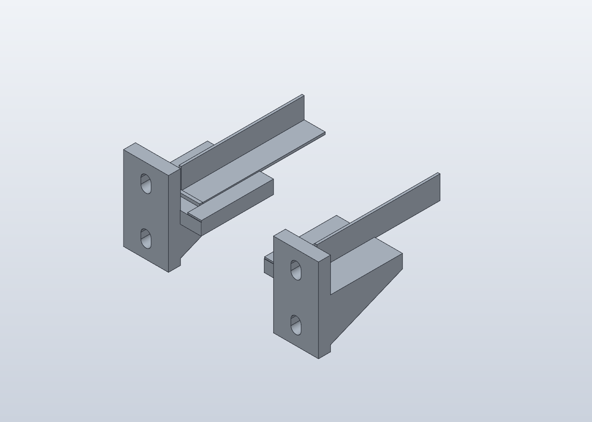
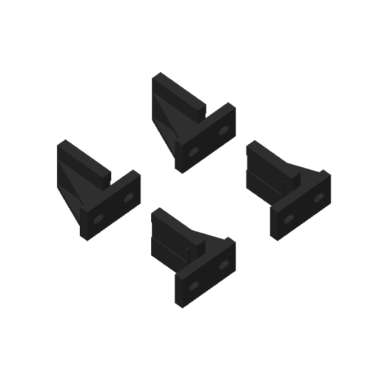

> **Correction après essai : [R3 — axe M4 à 35 mm, support arrière +5 mm](R3/README.md).** Utiliser R3 pour les trous du rail mesurés à 15, 35 et 50 mm.

# Berceaux de cornières L — prototype R1

**Mise à jour :** les supports arrière à gorge et verrou M4 sont disponibles dans [R2](R2/README.md). Les supports avant de cette R1 restent inchangés.

Quatre supports PETG portent les extrémités des deux cornières blanches. **Deux M6 par support : huit M6 au total.** Les supports se placent derrière les montants avant et devant les montants arrière, à l'intérieur de la baie. Les cornières sont coupées à longueur après présentation. Les fichiers V7 du châssis restent inchangés.

## Pièces

- `Supports_Rails_L_PETG_R1.solidcraft` : deux berceaux seuls, historique éditable SolidCraft.
- `Montage_berceaux_reference.solidcraft` : illustration avec deux tronçons de cornière. Leur longueur de 82 mm est illustrative ; **ces tronçons ne s'impriment pas**.
- `Plateau_4_berceaux_PETG_noir.3mf` : deux A et deux B, profil et tranchage Bambu inclus.
- `exports/BERCEAU-A.3mf` et `BERCEAU-B.3mf` : géométries seules, dans leur orientation d'impression.
- `exports/*.step` : géométries CAO ; le fichier d'ensemble est en orientation de montage.

## Placement dans la baie

Gauche et droite sont définies en regardant la baie depuis l'avant. Pour l'arrière, tourner la pièce indiquée de 180° autour de l'axe vertical, en conservant la tablette vers le haut.

| Emplacement | Pièce | Face d'appui de la platine |
|---|---|---|
| Avant gauche | A | Derrière le montant avant |
| Avant droit | B | Derrière le montant avant |
| Arrière gauche | B retournée de 180° | Devant le montant arrière |
| Arrière droit | A retournée de 180° | Devant le montant arrière |

Le décalage latéral place la cornière vers l'intérieur par rapport à l'axe des M6 : son bord extérieur est à 4 mm de cet axe, son aile horizontale s'étend jusqu'à 19,5 mm. Présenter le châssis pour vérifier qu'il porte bien sur l'aile horizontale et que l'aile verticale reste à l'extérieur de ses flancs. Ce décalage est une hypothèse de montage, pas une mesure issue des photos.

## Dimensions et réglages

| Élément | Valeur |
|---|---:|
| Cornière d'après l'étiquette photographiée | 15,5 × 15,5 × 1,5 mm |
| Largeur du berceau | 16,1 mm, soit 0,6 mm de jeu total |
| Épaisseur de platine / tablette | 8 / 8 mm |
| Profondeur totale depuis la face du montant | 56 mm |
| Butée de l'extrémité métallique | 18 mm de la face du montant |
| Longueur d'appui après la butée | 38 mm |
| Lumières M6 | 6,8 × 10,8 mm |
| Entraxe vertical des lumières | 31,75 mm |
| Enveloppe d'une pièce | 44 × 56 × 56 mm |

L'entraxe correspond à deux pas successifs de 15,875 mm : sélectionner les **premier et troisième trous d'un même groupe de trois**. Le pas entre deux groupes est différent. Référence : [guide de montage Dell, disposition universelle des trous](https://dl.dell.com/manuals/all-products/esuprt_ser_stor_net/esuprt_powervault/powervault-745n_setup%20guide_en-us.pdf).

Le passage M6 et le jeu autour du métal sont des valeurs de départ. Les essais J0.2/X0.2/M3/M4 de la V7 ne les valident pas. Le diamètre M6 est exposé dans le natif ; les autres cotes sont éditables dans les opérations ou dans `build.py`.

## Impression

PETG HF noir, X1 Carbon, buse 0,4 mm, plaque PEI lisse. Couches 0,20 mm, six parois, six couches dessus/dessous, 40 % de remplissage gyroid et bordure de 5 mm. Les deux formes sont couchées sur leur nervure extérieure, chacune dans le sens approprié. Elles sont préparées sans supports ; conserver cette orientation pour que la platine et la nervure commencent sur le plateau. Les températures et le débit proviennent du profil PETG HF déjà utilisé pour les essais.

Estimation du plateau complet : **3 h 38 et 139 g de PETG**. Identifier les deux pièces A et les deux B dans Bambu Studio et les marquer avant de les retirer du plateau.

## Montage

1. Présenter d'abord un berceau à vide. Vérifier le passage réel des M6, la planéité d'appui sur le montant et la place de la cornière. Les quatre surfaces de portée doivent être à la même hauteur ; vérifier aussi l'alignement des oreilles du châssis avant de serrer.
2. **Insérer les M6 depuis l'intérieur**, à travers la platine PETG, puis le montant, vers un écrou métallique du côté opposé. Prévoir des rondelles sous les têtes. Un écrou-cage déjà installé entre le montant et le support ne permet pas ce serrage : le déplacer sur la face opposée si son modèle le permet, ou utiliser un écrou M6 et une rondelle accessibles de l'autre côté. Ne pas visser simplement à travers un écrou-cage placé avant la pièce.
3. Adapter la longueur des vis à l'empilage réel : platine 8 mm, montant, rondelles et engagement complet de l'écrou. Les M6 courts de la baie ne sont pas forcément assez longs. Serrer les supports **avant** de poser les cornières, pour garder l'accès aux outils. Ne pas écraser le PETG au serrage.
4. Présenter puis couper les cornières. Mesurer entre les deux butées, conserver un petit jeu axial de montage et ébavurer les coupes. À titre de repère, les butées se trouvent chacune à 18 mm de leur face de montant ; la présentation réelle reste prioritaire. Mettre l'aile verticale de chaque L vers l'extérieur, et l'aile horizontale sous le châssis.
5. Poser les cornières dans les berceaux, puis poser le châssis dessus. Les bords de retenue sont plus bas que l'épaisseur du métal. Les butées limitent le déplacement longitudinal ; **le rail n'est pas verrouillé contre le soulèvement**.
6. Vérifier progressivement avec la masse réelle : aucune flexion excessive, fissure, basculement, glissement ni déformation persistante à chaud. Soutenir le châssis lors de sa sortie. Les nodes conservent leurs guides internes V7 ; ces supports ne sont pas des glissières télescopiques permettant de suspendre une charge entièrement extraite.

## Contrôles et limites

Les deux solides sont calculés dans SolidCraft et les maillages d'impression sont contrôlés. Le plateau contient exactement deux exemplaires de chaque forme. La profondeur de baie n'est pas figée et aucun perçage de cornière n'est imposé.

La résistance et le fluage du PETG sous la charge réelle ne sont pas qualifiés. La forme exacte des montants, l'accessibilité des écrous, la position du châssis et le jeu avec le métal peint restent à vérifier sur place. Aucun lancement d'impression n'est effectué.
