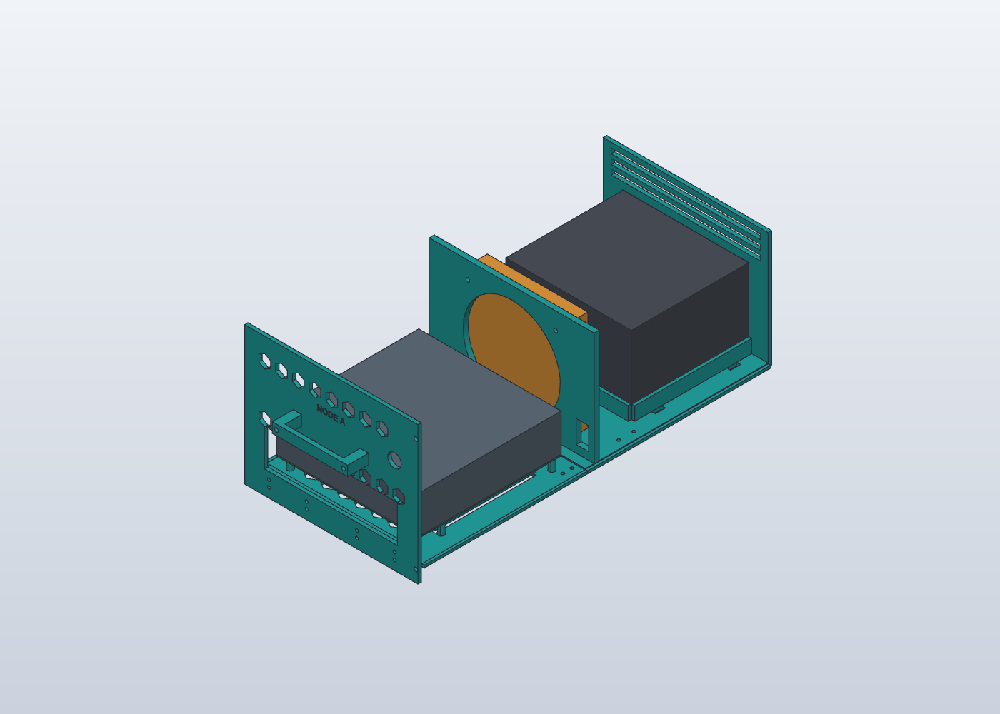

# Rack Blade V5 — deux cassettes complètes

Ouvrir **[RackTuringPi2_Complet_V5.solidcraft](../RackTuringPi2_Complet_V5.solidcraft)**. Le R4 est conservé. La V5 est un prototype géométrique ; les jeux et fixations réels doivent être validés avant fabrication de série.

## Architecture
Chaque cassette emporte désormais la façade, la poignée, le plateau de carte, le fond arrière, le ventilateur, l'alimentation et la paroi arrière. Le châssis fixe conserve seulement la structure, les guides, les cloisons et les capots. Les câbles externes doivent être débranchés avant extraction : aucune connexion automatique n'est prévue.

Les couleurs des vues servent à expliquer le montage. Toutes les pièces imprimées restent prévues en PETG noir. Les blocs gris et orange sont des **enveloppes d'encombrement**, pas des modèles détaillés des composants électroniques.

## Composants
Dans l'arborescence SolidCraft, **CASSETTE-D** et **CASSETTE-G** contiennent chacune 11 corps, dont cinq enveloppes REF. Pour déplacer un node complet, sélectionner son composant CASSETTE, pas seulement BT. Masquer les quatre composants TOP pour voir les équipements ; une translation du composant de −430 mm suivant Y montre la sortie complète. Revenir à Y = 0 pour la position fermée. Les anciens composants devenus vides restent dans l'historique pour conserver les dépendances du R4.

| Élément par cassette | Quantité | Fonction |
|---|---:|---|
| BT-D ou BT-G, modifié | 1 | Plateau avant portant la carte et ses entretoises |
| FOND-AR-D ou FOND-AR-G | 1 | Fond arrière, support de ventilateur, berceau PSU et paroi arrière intégrés |
| ECLISSE côté 1 et 2 | 2 | Liaison vissée sous les deux moitiés du fond |
| BF-D ou BF-G, modifiée | 1 | Façade et fenêtre I/O rehaussée |
| HANDLE-D ou HANDLE-G | 1 | Poignée séparée |

Les quadrants et cloisons sont modifiés pour un guidage jusqu'à l'arrière. L'ancienne paroi ventilateur FW est supprimée. L'oreille gauche reste intégrée au quadrant avant gauche ; l'oreille droite reste séparée. Les capots restent démontables.

## Modèle et fichiers
- Le fichier natif complet est l'autorité, avec historique et composants organisés.
- `exports/Assemblage_V5.step` contient l'assemblage ; `CASSETTE-D.step` et `CASSETTE-G.step` isolent chaque node, équipements de référence compris.
- `exports/*.3mf` contient les 25 références imprimables, orientées et posées à Z = 0. Ce sont des géométries, sans profil Bambu, sans supports calculés et sans affectation AMS.
- Les fichiers STEP dont le nom contient `vue` ou `Vue_extraction` sont des présentations ; ceux suffixés `_print` sont dans le repère d'impression.
- `build_commands.py`, les lots `01` à `03` et les corrections `02b`/`02c`, `04` et `05` retracent les opérations MCP effectuées sur R4. Les essais de mouvement et les exports ont aussi leurs traces dans `verification/`.

### Dimensions et modifications
Le châssis garde sa largeur de 446 mm, sa profondeur de 424 mm et sa hauteur de 176,5 mm. La course testée atteint 430 mm ; à cette position, la cassette est sortie des guides et doit être soutenue.

Le plateau avant est rehaussé de 8 mm pour passer au-dessus des pieds fixes de cloison : plancher à Z = 16 mm, dessous de carte à Z = 34 mm. La fenêtre de façade et ses trous de liaison sont adaptés à cette hauteur. Le fond arrière mesure environ **202,8 × 222,6 × 139 mm**, dans l'orientation fournie, avec une épaisseur de plancher de 4 mm. La séparation des deux fonds est à Y = 201 / 201,4 mm. Les éclisses font **14 × 100 × 4 mm**, avec quatre passages de vis Ø3,4 par éclisse.

Les languettes restent hautes de 3 mm. Les nouvelles rainures centrales sont hautes de 3,4 mm et les extérieures de 3,42 mm ; leurs jeux verticaux sont donc environ 0,2 mm par face. Le jeu en fond de rainure reste nominalement de 0,6 mm. Les jeux doivent être adaptés au résultat de la planche de tolérances.

L'alimentation de référence est maintenant à Z = 26 mm, dans un berceau mobile, avec des passages de sangles. Son enveloppe reste l'hypothèse héritée de **150 × 140 × 86 mm**, à relever sur l'alimentation réelle. Aucun perçage UNC de fixation PSU n'est inventé. Le ventilateur reste une enveloppe de **120 × 120 × 25 mm** ; son support comporte un passage d'air Ø116 et quatre trous Ø4,5 à entraxe 105 mm, à confronter au ventilateur réel.

Les fonds de 1 mm sous les poches hexagonales extérieures sont conservés. La paroi arrière amovible comporte l'ouverture PSU et trois fentes d'extraction. Jointoyer les raccords du châssis et des capots ; le joint central arrière prévoit un jeu de 0,3 mm. Le sens de montage des ventilateurs doit correspondre à l'entrée avant et à la sortie arrière.

## Impression et montage
1. **Valider les jeux.** Utiliser les éprouvettes PETG noir avec les réglages prévus pour les pièces finales. Contrôler particulièrement languettes, gorges et écrous.
2. **Imprimer un premier node.** Commencer par BT, FOND-AR et les deux éclisses d'un seul côté. Examiner le tranchage : les grands passages circulaires du support de ventilateur, les lumières arrière et les dessous des languettes peuvent nécessiter des supports. Les 3MF ne constituent pas une validation d'impression sans support.
3. **Réunir les fonds sur une surface plane.** Placer les deux éclisses sous les bords latéraux, entre Y = 180 et 280 mm. Aligner les huit passages de vis par node. Utiliser des vis M3 traversantes avec rondelles et écrous accessibles par le dessus ; déterminer leur longueur sur l'empilage réel (8 mm environ, plus rondelles et écrou). Vérifier que les têtes sous les éclisses ne touchent ni le plancher ni les pieds de cloison pendant le coulissement.
4. **Monter les équipements sur la cassette.** Installer le ventilateur sur sa paroi centrale, puis la PSU dans son berceau et la carte sur ses entretoises. Retenir la PSU avec les sangles adaptées aux passages, sans masquer ses prises d'air ni gêner le ventilateur. Le maintien définitif PSU et ses perçages restent à valider sur l'équipement réel.
5. **Monter la façade et la poignée.** Relier la façade au plateau par les quatre perçages adaptés à Z = 25 mm, puis monter la poignée. Vérifier l'accessibilité des connecteurs dans la fenêtre I/O. Les anciennes petites ouvertures de façade restent présentes ; ce n'est pas un panneau I/O dédié validé.
6. **Câbler le node sur établi.** Tous les câbles internes restent attachés à la cassette. Utiliser le passage latéral du support de ventilateur et maintenir les fils hors des rails et des pales. Aucun câble interne du node ne doit rester accroché au châssis fixe.
7. **Assembler le châssis et les guides.** Monter quadrants, biscuits, cloisons et oreille droite. Essayer la cassette vide puis équipée, en engageant simultanément ses deux languettes. Ne pas forcer ; vérifier toute la course à la main. Fixer les façades au châssis en position fermée, puis remettre les capots.

Le quadrant avant gauche intégré occupe environ **241,3 × 225 × 176,5 mm**, donc dépasse la limite conservatrice initiale de 240 mm. Vérifier sa place réelle sur le plateau, les zones interdites et la bordure dans Bambu Studio. Les autres références respectent l'enveloppe conservatrice contrôlée de 240 × 240 × 210 mm. Aucune impression n'est lancée par cette livraison.

### Retirer un node
Éteindre le node, débrancher secteur et câbles externes, libérer les vis latérales de retenue de la façade au châssis (laisser en place les quatre vis reliant la façade au plateau), puis tirer droit tout en soutenant la cassette. L'autre node reste dans ses guides. Ne pas laisser la cassette chargée en porte-à-faux à la sortie. La remettre en alignant les deux languettes, pousser sans forcer, refixer la façade puis rebrancher.

## Vérifications
Les contrôles finaux d'extraction portent sur **53 corps** : positions 0, 5, 25, 50, 100, 200, 300 et 430 mm, puis chaque cassette seule à 200 mm. Aucun chevauchement ni paire non vérifiée n'est rapporté dans ces contrôles finaux. Les premiers rapports de correction restent conservés dans le dossier d'audit ; utiliser `motion-final-*.json` pour les résultats après correction.

Ces essais sont des **positions discrètes**, pas une analyse continue du volume balayé. Ils ne modélisent ni les câbles souples, ni les vis, écrous et sangles réels. Le contrôle d'encombrement CAO ne valide pas la résistance mécanique ni les tolérances d'impression.

## Prochaines validations
- TODO(agent): reporter les tolérances mesurées et finaliser les entrées chanfreinées des rails.
- TODO(agent): vérifier les dimensions réelles PSU, ses fixations, la position de sa grille et la retenue des sangles.
- TODO(agent): confirmer la Turing Pi 2.5, les quatre RK1, les quatre SSD et la fenêtre I/O à leur nouvelle hauteur ; leurs volumes REF restent simplifiés.
- TODO(agent): qualifier la tenue du fond avant, des poches d'écrous héritées du R4, des éclisses, des poignées et des oreilles sous la charge complète. L'épaississement du fond arrière ne corrige pas automatiquement les faibles épaisseurs déjà signalées sur le plateau avant R1.
- TODO(agent): valider supports, ponts et premières couches au tranchage, puis l'étanchéité et les températures en charge. Une baie vide nécessite un obturateur pour l'essai de ventilation avec un seul node.

### Audit des exports
Les 25 maillages sont fermés et posés sur le plateau. Les quatre quadrants ont été retriangulés depuis les STEP avec Gmsh/OCC, puis comparés aux volumes et enveloppes CAO. Rapports : `verification/3mf-audit.json` et `verification/mesh-repair.json`. Les exports bruts sont conservés dans `verification/original-3mf/` uniquement pour audit ; ne pas les utiliser pour imprimer. Le dépassement de 240 mm du quadrant avec oreille est traité séparément des erreurs de maillage.
