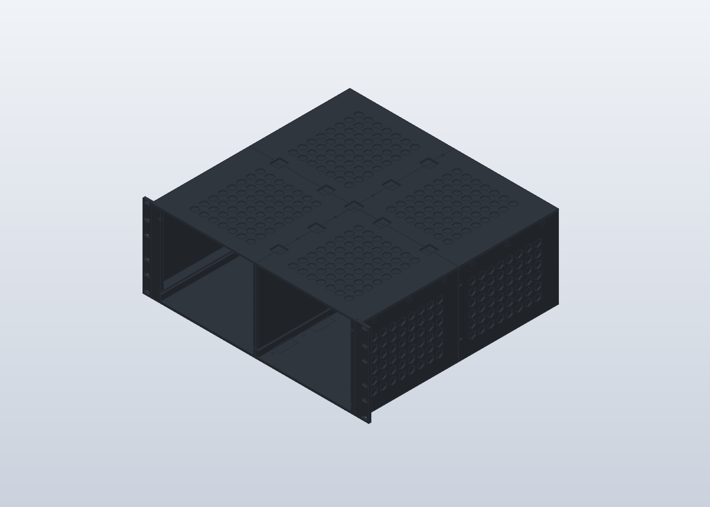
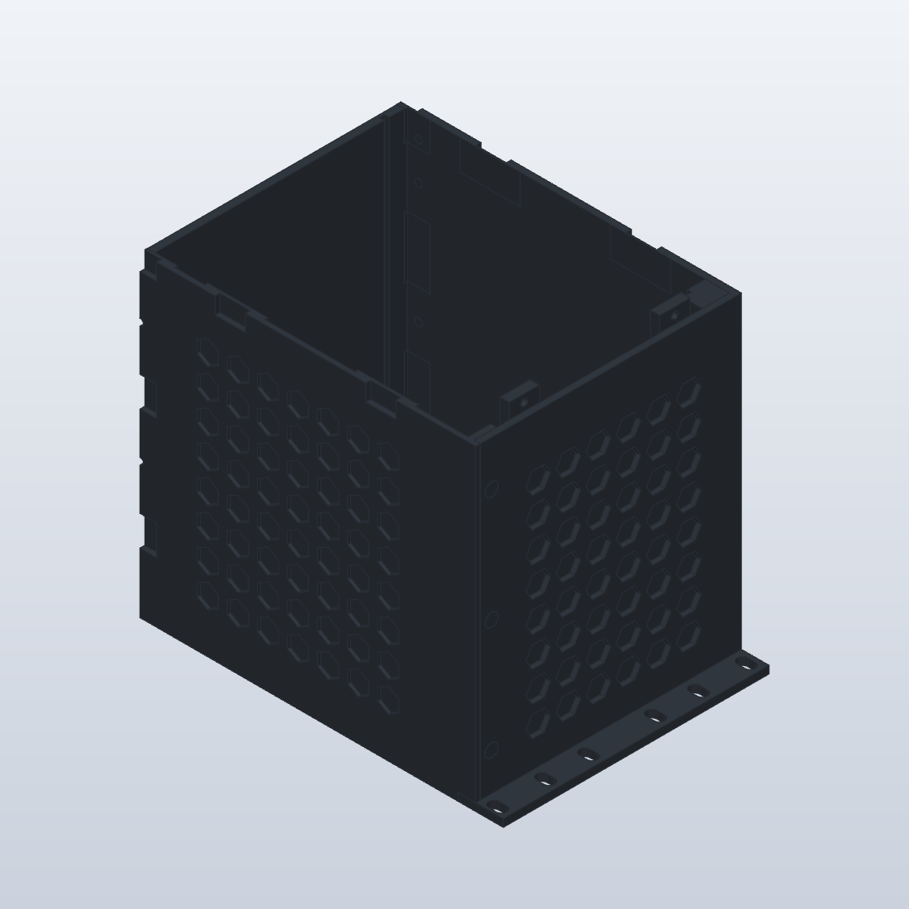

# Rack Blade V6 — quatre tunnels intégrés

Ouvrir [RackTuringPi2_Complet_V6.solidcraft](../RackTuringPi2_Complet_V6.solidcraft). La V5 est conservée. Cette version reste un prototype géométrique à valider avec les éprouvettes et les composants réels.

## Architecture

Chaque quadrant réunit le plancher, le côté extérieur, le toit et sa demi-cloison centrale en une seule pièce. La rainure centrale est intégrée. Deux demi-cloisons se présentent dos à dos, avec un jeu nominal de 0,3 mm. Les quatre tunnels sont imprimés debout, axe avant-arrière vertical, ouverture sur le plateau. Un dégagement de 0,05 mm sur l’extrémité avant de la demi-cloison droite évite le contact avec la façade fermée.

Les deux cassettes complètes de la V5 sont conservées : façade, poignée, carte, fond, ventilateur, alimentation et panneau arrière sortent ensemble. Le toit devient indémontable ; l'entretien s'effectue en retirant la cassette. Éteindre le node et débrancher ses câbles externes avant extraction.

Les poches hexagonales extérieures gardent leur fond de 1 mm. Jointoyer les raccords entre tunnels pour canaliser l'air de l'avant vers l'arrière. Une baie vide demande un obturateur si l'autre fonctionne.

## Composants

| Pièce fixe | Référence CAO conservée | Intégration V6 |
|---|---|---|
| Tunnel avant droit | Q-AV-D | Fond, côté, toit, demi-cloison, guide, oreille |
| Tunnel avant gauche | Q-AV-G-EAR | Fond, côté, toit, demi-cloison, guide, oreille |
| Tunnel arrière droit | Q-AR-D | Fond, côté, toit, demi-cloison, guide |
| Tunnel arrière gauche | Q-AR-G | Fond, côté, toit, demi-cloison, guide |

Les quatre TOP, les deux CL et EAR-D ne sont plus des pièces séparées. Les noms Q hérités sont conservés pour la continuité de l'historique. Les composants devenus vides peuvent subsister dans l'arborescence.

Les oreilles avant sont toutes deux intégrées au plan Y = 0…5 mm. Leur face d'appui est avancée dans le boîtier de 5 mm par rapport à la V5 (ancien plan Y = −5 mm). Cela donne une rive avant plane pour imprimer le tunnel debout. La largeur hors oreilles reste 446 mm et la largeur avec oreilles 482,6 mm. Les positions X/Z des lumières de fixation au rack restent inchangées.

**Vis supprimées :** liaison des capots, des cloisons centrales et des oreilles aux quadrants. **Assemblages conservés :** liaisons entre les quatre tunnels, biscuits, fixation du rack, retenue des façades et assemblage des cassettes. Les biscuits servent à l'alignement ; ne pas les considérer seuls comme un verrouillage structurel qualifié.

## Modèle et fichiers

Le natif SolidCraft contient l'assemblage complet et l'historique paramétrique. `build_commands.py` produit les lots MCP 00, 01 et 02 appliqués à la V5. Le lot `05-front-clearance.json` ajoute le dégagement final ; `04-av-d-ear-first.json` conserve le lot effectivement exécuté, identique au 01-AV-D final. Les résultats et contrôles sont dans `verification/`.

Le jeu comporte 18 références imprimables, contre 25 en V5. Les biscuits sont à dupliquer selon les raccords de l’assemblage (16 BIS et 2 BIS-X au total).

L’archive `V6_Pieces_PETG_noir.zip` réunit le natif V6, les 18 références 3MF et les notices illustrées V6/V5. Les STEP et les rapports détaillés restent dans le dossier du projet.

Les 3MF du dossier `exports/` sont des géométries à importer dans Bambu Studio, sans profil machine, sans tranchage et sans supports calculés. Les deux cassettes et les biscuits non modifiés proviennent des exports vérifiés V5. Tout s'imprime en **PETG noir**, les couleurs CAO ne sont qu'une aide au montage.

## Impression et montage

1. **Reprendre les jeux des éprouvettes.** Contrôler particulièrement les biscuits et les languettes de 3 mm dans les gorges de 3,4 mm. Le jeu vertical théorique vaut environ 0,2 mm par face ; aucune correction spécifique à l'imprimante n'est supposée sans mesure.
2. **Importer un tunnel seul.** L'ouverture est sur le plateau et l'axe du tunnel est vertical. Ne pas utiliser l'orientation automatique qui remettrait le fond à plat. Les tunnels avant ont une emprise d'environ 241,3 × 176,5 mm et une hauteur de 220 mm ; les arrière environ 223,1 × 176,5 mm, hauteur 213,8 mm. Ces dimensions dépassent l'ancienne enveloppe conservatrice 240 × 240 × 210 mm : vérifier le modèle Bambu, ses zones interdites et la place d'une bordure dans le trancheur.
3. **Examiner les couches.** Vérifier la continuité de la première couche sur le périmètre du tunnel, les poches hexagonales, les logements de biscuits et les extrémités de guide. L'orientation verticale simplifie l'impression des grandes parois mais ne garantit pas l'absence de supports. Prévoir l'accès pour retirer tout support dans le tunnel.
4. **Assembler les quatre tunnels sur une surface plane.** Identifier AV/AR et D/G. Poser les biscuits aux raccords du plancher et du toit, engager les jonctions avant-arrière et conserver leurs fixations. Aligner les gorges sans marche au raccord. Réunir les deux côtés ; les demi-cloisons se retrouvent au milieu. Aucun toit ni cloison à visser séparément.
5. **Contrôler le guidage à vide.** Engager les deux languettes d'une cassette simultanément et faire toute la course sans forcer. Corriger les bavures ou les marches avant d'installer l'électronique. Jointoyer les raccords fixes hors des gorges.
6. **Monter les cassettes.** Suivre la [notice V5](../V5/README.md#impression-et-montage) pour les fonds avant/arrière, les deux éclisses et leurs huit M3 par node, la façade, la poignée, le ventilateur et les équipements. Tous les câbles internes doivent suivre la cassette. Les étapes V5 de montage des capots, cloisons et oreille séparée sont remplacées par l'étape 4 ci-dessus.
7. **Installer le rack et essayer chaque node.** Fixer les oreilles au rack en conservant un support adapté au poids du châssis. Insérer et retenir les façades, puis brancher. Pour retirer un node, débrancher ses câbles externes et libérer sa façade ; soutenir la cassette pendant la sortie, particulièrement lorsqu'elle quitte complètement les guides.

## Comment tester

Les 46 corps passent le contrôle fermé et les positions d’extraction 5, 25, 50, 100, 200, 300 et 430 mm. Chaque cassette est également contrôlée seule à 200 mm. Aucun chevauchement ni paire non vérifiée dans les résultats retenus : `motion-closed-final.json`, `motion-final-{5…430}.json`, `motion-independent-D.json` et `motion-independent-G-final.json`. Les premiers essais avant correction sont conservés pour traçabilité. Le dégagement final enlève seulement de la matière : les positions déjà libres le restent. Les contrôles CAO utilisent des positions discrètes, sans modéliser les vis, câbles et sangles. Ils ne qualifient ni la résistance du PETG sous charge et température, ni la tenue des oreilles et des assemblages.

Les enveloppes d'équipements héritées restent provisoires : PSU 150 × 140 × 86 mm, ventilateur 120 × 120 × 25 mm. Vérifier les dimensions réelles du Cooler Master MWE 750 V3, de la Turing Pi 2.5 avec RK1 et dissipateurs, et les accès aux connecteurs avant de fabriquer toutes les pièces.

## Prochaines améliorations

- TODO(agent) : intégrer les tolérances mesurées et qualifier un tunnel avec une cassette vide.
- TODO(agent) : contrôler la charge complète, le maintien PSU, les parois fines du plateau avant et les fixations héritées de la V5.
- TODO(agent) : valider le tranchage réel, les supports, l'étanchéité des raccords et les températures en charge.

La réouverture indépendante du natif reconstruit **861 opérations et 46 solides, sans erreur**, avec les volumes identiques à la session de construction. Rapport : `verification/reload-v6.json` ; synthèse : `verification/summary.json`.

## Audit des exports

Les 18 maillages sont fermés, orientés correctement et posés à Z = 0. Les quatre tunnels sont retriangulés depuis leurs STEP avec Gmsh/OCC ; les rapports sont `verification/3mf-audit.json` et `verification/mesh-repair.json`. Le tunnel arrière gauche nécessite une rectification numérique de 0,005 mm maximum sur son extrémité arrière pour supprimer une arête dégénérée : écart d’enveloppe mesuré 0,0048 mm et écart de volume 0,0072 %. Cette correction concerne le 3MF uniquement ; le natif et le STEP sont préservés. Les fichiers bruts dans `verification/original-3mf/` sont réservés à l’audit et ne doivent pas être imprimés.

Le contrôle d’enveloppe conservateur 240 × 240 × 210 mm signale les quatre tunnels ; ce résultat est distinct de la validité du maillage. Vérifier leur placement sur la machine réelle dans Bambu Studio.
