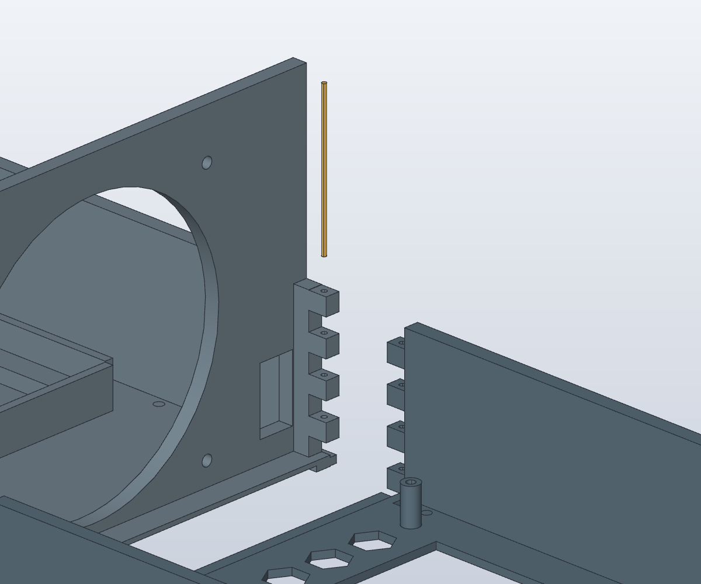
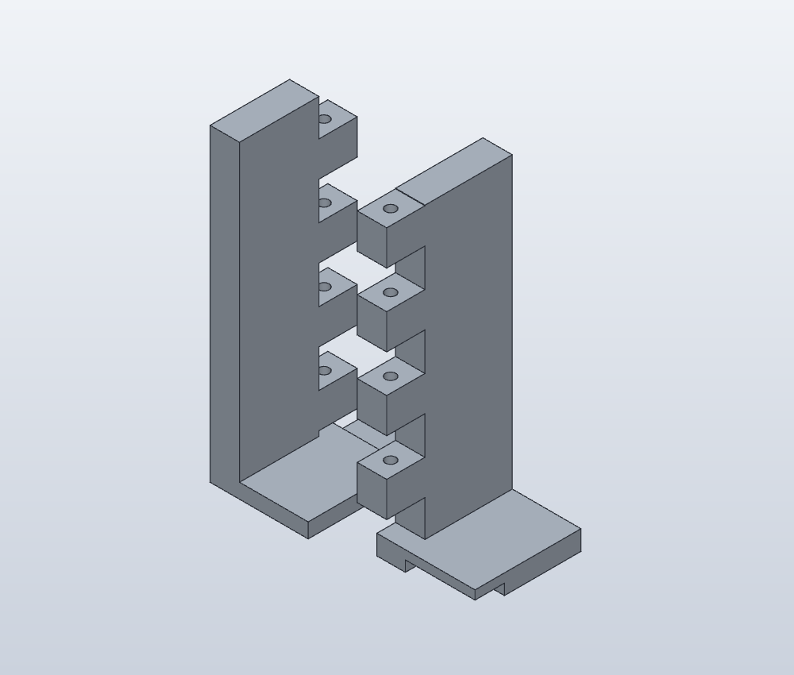

# V7 calibrée — cassettes à murets, verrouillées par filament

Révision du 25 octobre 2026 : **J0.2, X0.2, passages M3 3,2 mm et M4 4,3 mm, écrous M3 5,7 mm et M4 7,2 mm entre plats**, selon les essais obtenus sans retouche. Voir [calibration](calibration/README.md) et les [projets Bambu par plateau](plateaux/README.md).

Cette variante remplace les éclisses vissées reliant les fonds avant et arrière des deux nodes. Le châssis à quatre tunnels de la V6 est conservé.

Les couleurs des vues servent au repérage ; toutes les pièces restent prévues en PETG noir. Le filament est représenté en jaune dans le détail ci-dessous.

## Principe

Deux murets longitudinaux d'environ **60 mm de haut et 6 mm d'épaisseur** sont intégrés aux bords de chaque cassette. À la séparation du fond, leurs huit doigts alternés s'entrelacent. Un morceau de filament de **1,75 mm**, inséré verticalement de chaque côté, verrouille la jonction. Le passage nominal est de **2,1 mm**, à ajuster après essai.

La géométrie est une adaptation originale inspirée du principe d'assemblage par filament décrit sur la [fiche Modubox ALCH](https://www.alch.shop/modubox-alex/p/modubox-ikea-alex-drawer-organizer). La [vidéo fournie, à 8:31](https://youtu.be/VcB30EIcUMY?t=511), reste la référence visuelle de l'utilisateur ; les cotes internes de son mécanisme n'ont pas été relevées. Aucun fichier commercial Modubox n'est inclus.

Les murets et leurs doigts reprennent les efforts au raccord. Le filament empêche la séparation ; sa tenue réelle doit être testée sous charge. Une languette intégrée au plancher recouvre le joint sur environ 6 mm et se loge dans une feuillure du fond arrière, avec un jeu vertical nominal de 0,2 mm. Les doigts ont un jeu vertical nominal de 0,3 mm.

Les **quatre éclisses et leurs seize vis M3 de jonction disparaissent**. Les anciens trous de jonction situés dans le fond plein sont rebouchés ; les ouvertures déjà dégagées au bord restent libres. Les nervures sous le fond avant sont retirées pour obtenir une base plane. Les vis de fixation de la carte, du ventilateur, des façades et du rack restent nécessaires. Le support transversal du ventilateur et le panneau arrière conservent leur hauteur fonctionnelle ; les nouveaux murets sont uniquement longitudinaux, pour laisser circuler l'air d'avant en arrière.

## Composants et fichiers

- `RackTuringPi2_Complet_V7.solidcraft`, dans le dossier parent : assemblage complet, dérivé de V6.
- `BT-D`, `BT-G`, `FOND-AR-D`, `FOND-AR-G` : quatre pièces modifiées.
- `REF_FILAMENT-D/G-1/2` : enveloppes des morceaux de filament, à couper dans du filament existant, **pas à imprimer**.
- `Test_jonction_V7.solidcraft` et `exports/TEST-JONCTION.3mf` : petit joint complet en deux pièces, avec les mêmes doigts, jeu et recouvrement que le node. Il permet un essai d’emboîtement avant les grands fonds.
- `Test_filament_V7.solidcraft` et `exports/TEST-FILAMENT.3mf` : éprouvette indépendante.
- Toutes les références du rack sont réexportées depuis la V7 calibrée ; les références ECLISSE sont supprimées. Les deux éprouvettes de filament, indépendantes des tolérances mesurées, restent inchangées.

## Tester le passage du filament

L'éprouvette possède quatre colonnes de passage long, repérées par **1, 2, 3 ou 4 encoches** sur le bord du socle :

| Encoches | Diamètre nominal |
|---|---:|
| 1 | 1,9 mm |
| 2 | 2,0 mm |
| 3 | 2,1 mm |
| 4 | 2,2 mm |

Imprimer en PETG noir avec les réglages prévus pour les murs. Introduire un morceau droit du filament réellement utilisé. Retenir un passage permettant l'insertion et le retrait sur toute la longueur sans forcer ni casser le filament. Cette éprouvette contrôle le diamètre et le frottement. Le fichier TEST-JONCTION fournit ensuite deux demi-joints à assembler et à verrouiller avec un filament. Un seul côté est reproduit : cet essai ne qualifie pas à lui seul la résistance de la cassette complète.

## Impression et montage

1. Imprimer l'éprouvette, puis les deux fonds d'un seul node pour valider le principe avant de multiplier les pièces.
2. Imprimer les fonds à plat, murets et axes des passages verticaux. Les doigts dépassant de la ligne du fond et le recouvrement peuvent nécessiter des supports ; contrôler leur accessibilité dans Bambu Studio. Les 3MF de `exports/` sont des géométries ; les 3MF de `plateaux/` sont les projets Bambu avec placement, profil et tranchage.
3. Ébavurer les doigts et nettoyer les passages. Poser les fonds sur une surface plane, engager le recouvrement inférieur et entrelacer simultanément les doigts des deux côtés.
4. Couper **deux morceaux droits d'environ 61 mm de filament 1,75 mm par node**. Les introduire par le dessus dans les axes de la jonction. Un fond fermé dans le premier doigt limite leur descente ; une courte extrémité reste accessible pour le retrait. Contrôler la retenue réelle : aucune résistance à l'arrachement ou aux vibrations n'est encore qualifiée.
5. Tester le joint à vide : pas de marche du fond, pas de basculement ni d'ouverture au raccord. Essayer la cassette dans ses deux guides, puis tester progressivement avec une charge représentative et un support sous la cassette sortie.
6. Installer les équipements et leurs fixations sur la cassette. Conserver tous les câbles internes sur le node, hors des guides et des pales. Le montage des éclisses décrit dans la notice V5 est désormais obsolète.
7. Avant extraction du rack, éteindre et débrancher les câbles externes. Soutenir la cassette à sa sortie. Pour séparer les deux fonds sur établi, décharger les équipements qui contraignent la jonction, retirer les deux filaments, puis désengager les doigts et le recouvrement.

## Châssis et rack

Les quatre tunnels et leurs guides restent ceux de V6. Réunir les tronçons avant/arrière et les côtés en alignant les gorges ; utiliser les biscuits et les fixations de raccord conservées. Les fichiers BIS et BIS-X sont des références à dupliquer : 16 BIS et 2 BIS-X sont présents dans l’assemblage. Jointoyer les raccords fixes hors des glissières pour préserver le flux avant-arrière. Fixer le châssis au rack avec un support adapté à la charge. Les murets de cassette remplacent uniquement les anciennes éclisses, pas les fixations structurelles du rack.

## Limites et prochaines validations

Le passage de 2,1 mm et les jeux de 0,2/0,3 mm sont des valeurs de départ, pas les résultats d'une mesure sur votre imprimante. Les équipements restent des enveloppes simplifiées héritées de V6. Les vérifications géométriques ne remplacent pas l'essai mécanique du PETG et des goupilles sous la masse réelle de la carte, du refroidissement et de l'alimentation.

- TODO(agent) : reporter le diamètre retenu sur l'éprouvette et contrôler les doigts sur une première cassette.
- TODO(agent) : qualifier la retenue des goupilles et la tenue du joint à chaud, en traction et en flexion.
- TODO(agent) : confirmer les dimensions réelles PSU/RK1, le câblage et le flux d'air en charge.

## Vérifications et traçabilité

Les rapports de la construction initiale V7 restent dans `verification/` ; `summary-avant-calibration.json` conserve leur ancienne synthèse. `summary.json` et `3mf-audit.json` décrivent désormais la livraison calibrée. Ceux de la calibration sont dans `calibration/verification/` ; ils documentent le recalcul natif, les mesures, les interférences et les exports. Ne pas confondre les essais historiques avec les contrôles de cette révision.

Les poches hexagonales conservent leur fond de 1 mm et le flux d'air reste orienté de l'avant vers l'arrière. Les quatre tunnels conservent leur architecture V6 ; leurs logements d'écrous et passages de vis utilisent désormais les dimensions mesurées. Le petit dégagement axial à l'entrée du guide droit passe de 0,05 à 0,06 mm pour stabiliser une découpe booléenne ; la section de coulissement reste inchangée.

Les maillages sont contrôlés avant leur utilisation dans les projets Bambu. Les exports bruts et les rapports de retriangulation sont conservés pour audit. L'enveloppe conservatrice historique de 240 × 240 × 210 mm ne correspond pas à la machine : les projets sont contrôlés contre le plateau X1 Carbon de 256 × 256 mm, sa zone interdite avant gauche et sa hauteur de 250 mm.

Les contrôles géométriques ne qualifient pas les performances mécaniques ou thermiques du prototype. Les paramètres de guidage et de verrouillage par filament restent à tester physiquement. Les scripts de construction initiaux conservent leur rôle de traçabilité ; `calibration/update_source.py` applique les résultats mesurés à la sauvegarde d'origine.

La retriangulation conserve des écarts d’enveloppe inférieurs à 0,01 mm et de volume inférieurs à 0,02 %. Le maillage du tunnel arrière gauche reprend une correction numérique de 0,005 mm à son extrémité, sans modifier le STEP ni le natif.
