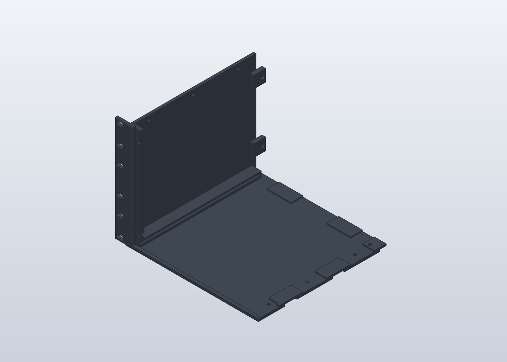
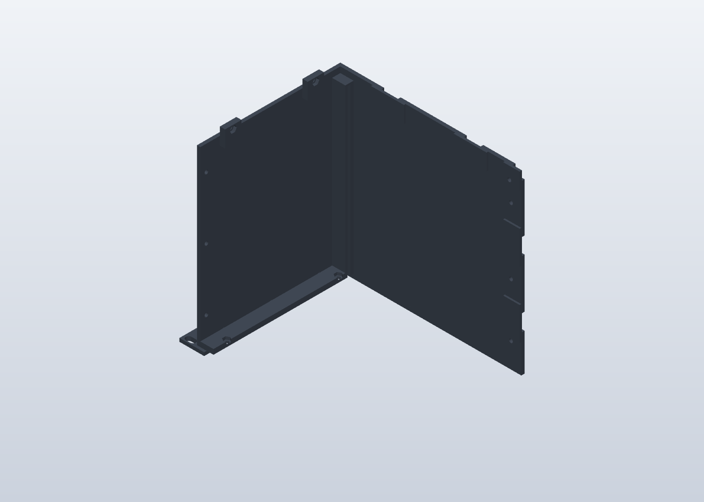

# Variante avant gauche : quadrant et oreille réunis

## Architecture
Variante d'étude demandée le 25 octobre 2026. Le modèle R3 original est conservé. Q-AV-G et EAR-G sont réunis ; TOP-AV-G reste démontable. Les poches hexagonales R3 et leurs fonds continus de 1 mm restent inchangés.

## Composants
La nouvelle pièce remplace seulement Q-AV-G et EAR-G. Les trois passages de vis et logements d'écrous de leur liaison sont rebouchés. Les lumières de fixation au rack restent présentes. Une prolongation du fond de 5 mm vers l'avant, épaisseur 4 mm, donne un appui de première couche en complément de l'oreille.

## Modèle
`construction.json` contient les opérations additionnelles exécutées par MCP SolidCraft sur le natif R3. `Rack_variante_oreille_G.solidcraft` conserve l'assemblage et son historique. `Q-AV-G-EAR.step` est dans le repère d'assemblage ; `Q-AV-G-EAR_face-avant.3mf` est orienté face avant sur le plateau, sans profil de tranchage. Rotation +90° autour de X, translation [241,3 ; 176,5 ; 5,0003871311] mm.

### Vérifications réalisées
- Un corps, une coque ; volume mesuré 358 497,007 mm³.
- Contrôle exact des 49 corps de l'assemblage : zéro collision, zéro paire non vérifiée. Rapport : `verification-interferences.json`.
- Le maillage exporté occupe 241,30046 × 176,5 × 225,00066 mm ; Z minimal nul à la précision numérique.
- Les opérations de rebouchage ont nécessité une reprise automatique des booléens par SolidCraft (déplacement inférieur à 0,001 mm). Les traces circulaires visibles sur la face sont des arêtes de ces raccords, pas des passages ouverts.
- Les six lumières de l'oreille sont conservées sur le rendu. Le capot et les autres pièces n'ont pas été fusionnés.
- Le contrôle porte sur l'assemblage fermé, pas sur toute la course dynamique du tiroir. Supports, tranchage et résistance mécanique restent à valider.

## Comment tester
- Imprimer d'abord les éprouvettes de tolérances prévues et reporter les jeux validés avant une fabrication définitive.
- Ouvrir le 3MF dans Bambu Studio, PETG HF noir, plaque lisse réellement installée. Contrôler l'adhérence selon les consignes de cette plaque.
- Encombrement attendu face avant posée : 241,3 × 176,5 mm, hauteur 225 mm. Cette variante dépasse l'enveloppe conservatrice initiale de 240 × 240 × 210 mm. Contrôler la zone exclue du plateau et la marge de bordure dans le trancheur.
- Le cadre avant comporte des débords : inspecter couche par couche les surfaces qui commencent dans le vide et placer les supports locaux nécessaires. Ne pas considérer cette orientation comme validée sans supports.
- Laisser libres les rails, les logements de biscuits et les écrous fonctionnels. Retirer les supports avant l'essai du tiroir et du capot.
- Vérifier le coulissement du tiroir, les joints de capot et l'accès aux fixations du rack. Un contrôle de collision CAO ne qualifie pas la résistance mécanique des oreilles imprimées.

## Prochaines améliorations
Comparer le tranchage face avant posée à l'orientation fond posé (encombrement 241,3 × 225 mm, hauteur 176,5 mm), puis choisir selon les supports et l'adhérence constatés. Ne pas lancer la série avant cet essai. Aucun lancement d'impression n'est associé à cette variante.
