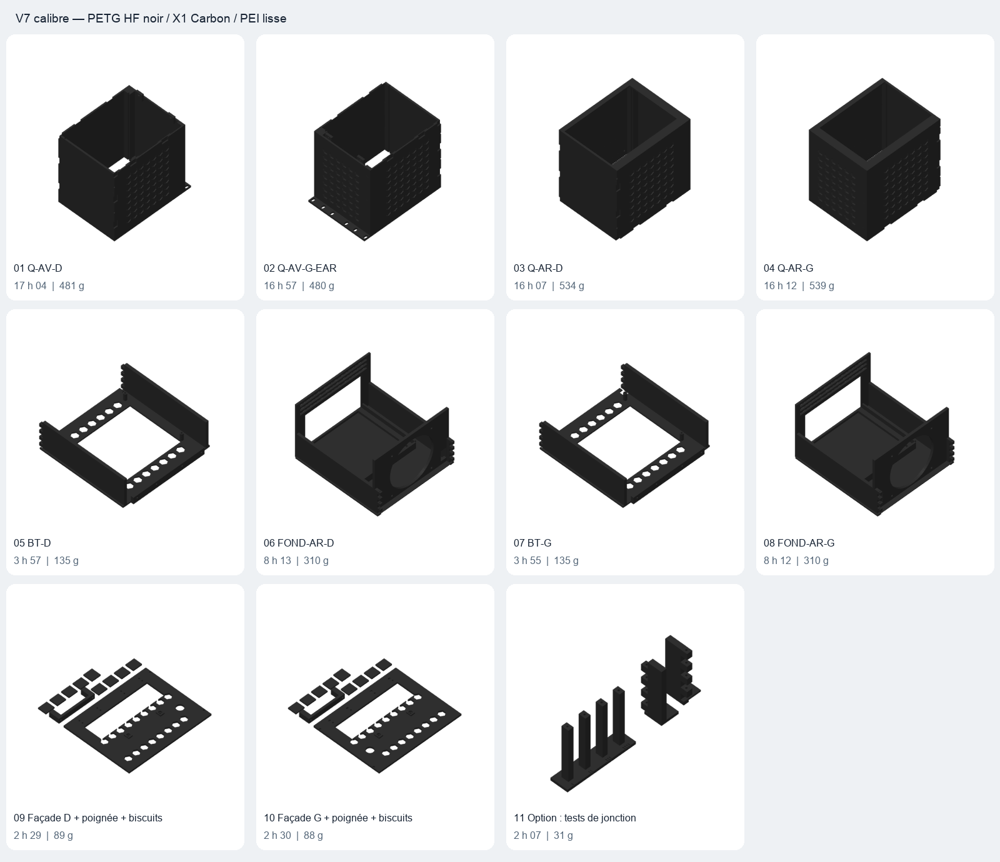
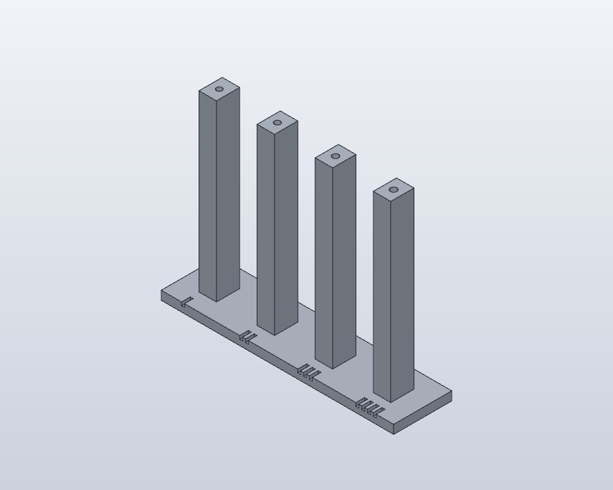

[Lire en français](../fr/printing.md)

# Printing guide

## 1. Open the correct projects

Use the calibrated V7 **plateaux** files, opened as projects in Bambu Studio. Files in **exports** are geometry only. The prepared projects target **X1 Carbon, 0.4 mm nozzle, smooth PEI plate and black PETG HF**. Select the actual loaded filament when sending a job; no fixed AMS slot is assumed.

## 2. Test the unqualified joint first

Start with optional plate 11. The filament coupon has four channels: one notch = 1.9 mm, two = 2.0 mm, three = 2.1 mm, four = 2.2 mm. Test insertion and removal of the actual filament over the full length. Then assemble the two joint coupons. The default 2.1 mm passage has **not** been confirmed by the earlier nut/biscuit tests.

## 3. Keep the supplied orientations

- Tunnels: standing vertically, tunnel opening on the plate.
- Cassette floors: flat floor down, walls and pin passages vertical.
- Front panels: front face down.
- Rail R3 rear saddles: M6 mounting plate down; fronts retain the provided side orientation.

V7 uses 0.16 mm layers, a 0.2 mm first layer, two walls and 15% infill from the tested process. Support settings vary by plate; tunnels have a 5 mm brim. Front-panel/biscuit plates have no supports. Inspect the actual sliced layers: preview pictures do not show all generated supports. Remove supports from sliding and interlocking surfaces without altering their nominal size.

Rail supports use a different process: 0.20 mm layers, six walls, 40% gyroid infill and a 5 mm brim, without supports. Do not apply the rack profile to the rail saddles by accident.

## 4. Print progressively

After plate 11, print plates 05 and 06 for one node, test the joint, then test its fit with the enclosure. Print each production plate 01–10 once. Do not add another XY compensation: J0.2 and X0.2 are **total** XY clearances, not per-side values.

| Plate | Contents | Estimated time | PETG |
|---|---|---:|---:|
| 01 | Q-AV-D | 17 h 04 | 481 g |
| 02 | Q-AV-G-EAR | 16 h 57 | 480 g |
| 03 | Q-AR-D | 16 h 07 | 534 g |
| 04 | Q-AR-G | 16 h 12 | 539 g |
| 05 | BT-D | 3 h 57 | 135 g |
| 06 | FOND-AR-D | 8 h 13 | 310 g |
| 07 | BT-G | 3 h 55 | 135 g |
| 08 | FOND-AR-G | 8 h 12 | 310 g |
| 09 | BF-D + HANDLE-D + 8 BIS + 1 BIS-X | 2 h 29 | 89 g |
| 10 | BF-G + HANDLE-G + 8 BIS + 1 BIS-X | 2 h 30 | 88 g |
| 11 | TEST-FILAMENT + TEST-JONCTION | 2 h 07 | 31 g |

Production estimate: approximately **95 h 40 / 3.10 kg**, excluding optional coupons and rail saddles. Rear R3 pair: **2 h 26 / 86 g**. Complete R3 saddle set: **4 h 12 / 155 g**. These are slicer estimates, not measured printing durations.

Proceed to [assembly](assembly.md). Physical load and temperature qualification remains necessary; the tested two-wall process does not establish the strength of a loaded rack.
