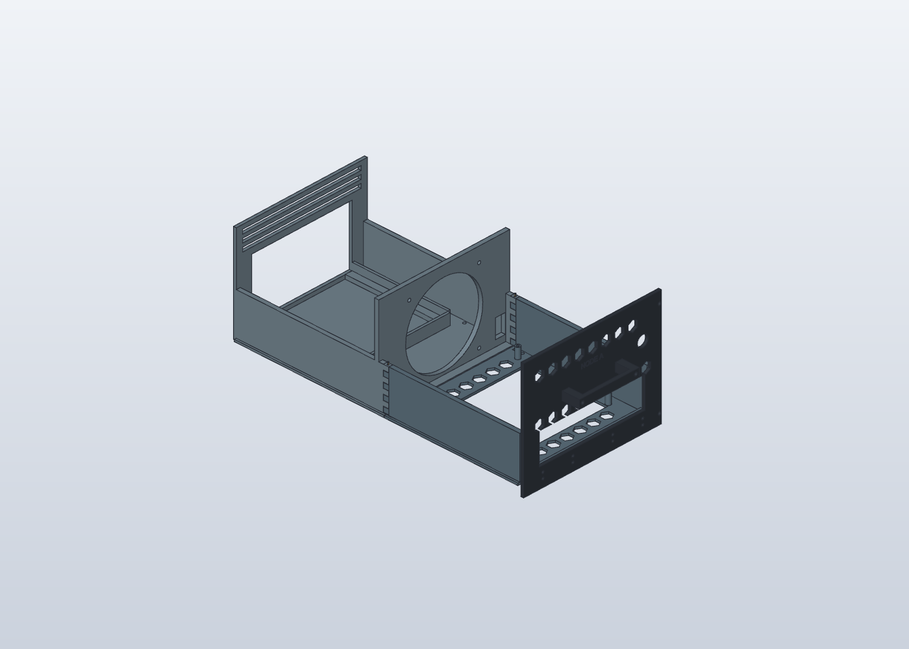
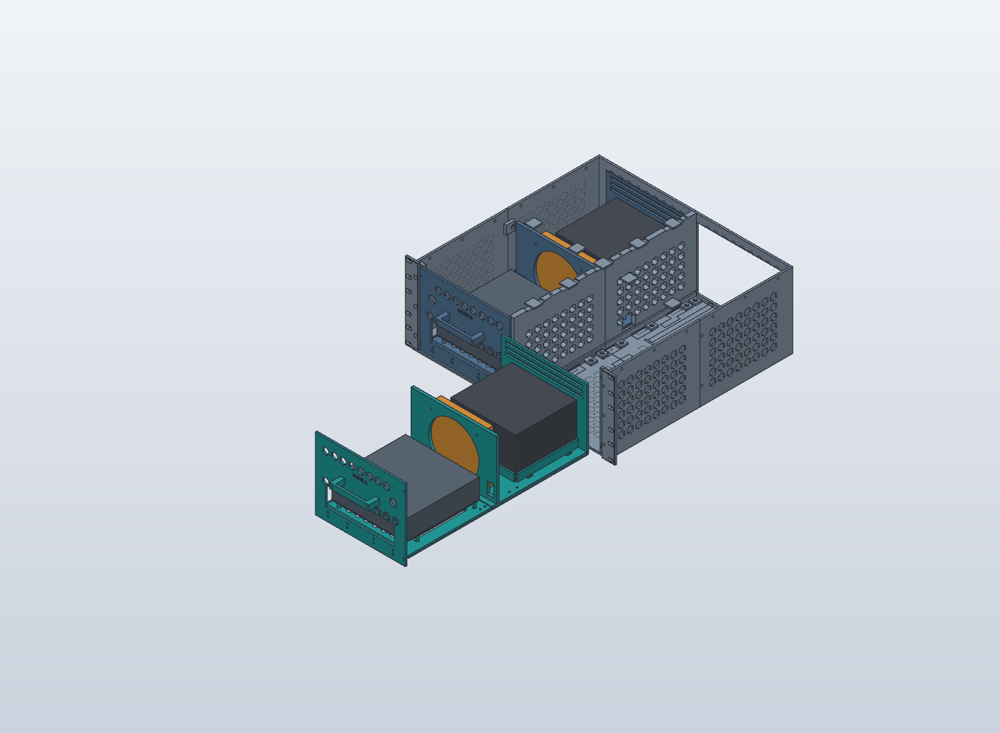

[Read in English](../en/assembly.md)

# Notice de montage illustrée — V7

## 1. Identifier et préparer les pièces

Disposer les quatre tunnels, deux fonds avant, deux fonds arrière, deux façades, deux poignées, 16 BIS et deux BIS-X. Séparer les ensembles gauche et droit. Retirer les supports d’impression et inspecter les rainures. Ne pas monter les anciennes éclisses V5 ni les toits/cloisons séparés des versions antérieures.

**Contrôle :** toutes les pièces présentes, gabarits REF exclus, passages des guides dégagés.

## 2. Assembler une cassette vide

Poser BT et FOND-AR sur une surface plane. Engager le recouvrement du plancher et entrelacer simultanément les doigts des deux murets. Le fond doit rester de niveau au raccord. Introduire par le dessus deux morceaux droits de filament 1,75 mm, d’environ 61 mm. Garder une courte extrémité accessible pour le retrait.

**Contrôle :** absence de basculement, de joint ouvert et de goupille forcée. Essayer d’abord l’éprouvette si la jonction coince. Les goupilles verrouillent le raccord ; leur résistance sous charge n’est pas encore qualifiée.

## 3. Assembler le châssis fixe

Présenter les tunnels avant et arrière de chaque côté à blanc. Aligner leurs rainures intérieure et extérieure avant de poser les biscuits. Réunir gauche et droite avec les biscuits centraux et les fixations structurelles conservées. Les BIS/BIS-X alignent les raccords ; ne pas les considérer seuls comme une retenue de charge validée.

**Contrôle :** continuité des deux guides au raccord avant/arrière. Essayer une cassette vide sur toute la course sans forcer. Jointoyer les raccords fixes hors des surfaces mobiles pour maintenir le flux avant-arrière.

## 4. Installer ventilateur, alimentation et carte

Travailler sur la cassette sortie. Fixer le ventilateur sur son support, flux prévu vers l’arrière. Placer la PSU dans son berceau et la retenir par les sangles prévues sans masquer son aspiration. Poser la Turing Pi sur ses entretoises ; vérifier le dégagement NVMe sous la carte et la hauteur du refroidissement avant serrage.

**Contrôle :** matériel réel compatible, guides libres, aspiration PSU dégagée, vis sans contact avec l’électronique. Les positions de perçage PSU et sa retenue définitive ne sont pas figées par les enveloppes CAO simplifiées.

## 5. Ajouter façade, poignée et câblage

Fixer BF au fond avant, puis sa poignée. Vérifier la fenêtre I/O avec les connecteurs réels de la Turing Pi 2.5. Attacher tous les câbles internes à la cassette, en utilisant le passage du support ventilateur, loin des pales et des rainures. Aucun câble interne du node ne doit rester accroché au châssis fixe.

**Contrôle :** la retenue de façade peut être libérée sans retirer les vis qui relient la façade au plateau ; tout le câblage interne se déplace avec le node.

## 6. Installer les supports de baie et essayer l’extraction

Suivre la procédure des [rails](rails.md). Soutenir le châssis sur ses zones d’appui et contrôler le dégagement au-dessus du toit du verrou M4 arrière. Engager simultanément les deux guides de la cassette, puis retenir sa façade.

Pour retirer : éteindre, débrancher secteur et câbles externes, libérer la retenue avant, puis tirer droit en soutenant la cassette. La position CAO de 430 mm est hors des guides : **ne pas laisser la cassette chargée en porte-à-faux**. Réinsérer dans l’ordre inverse. Les essais thermiques et de charge viennent après l’ajustement à vide.
