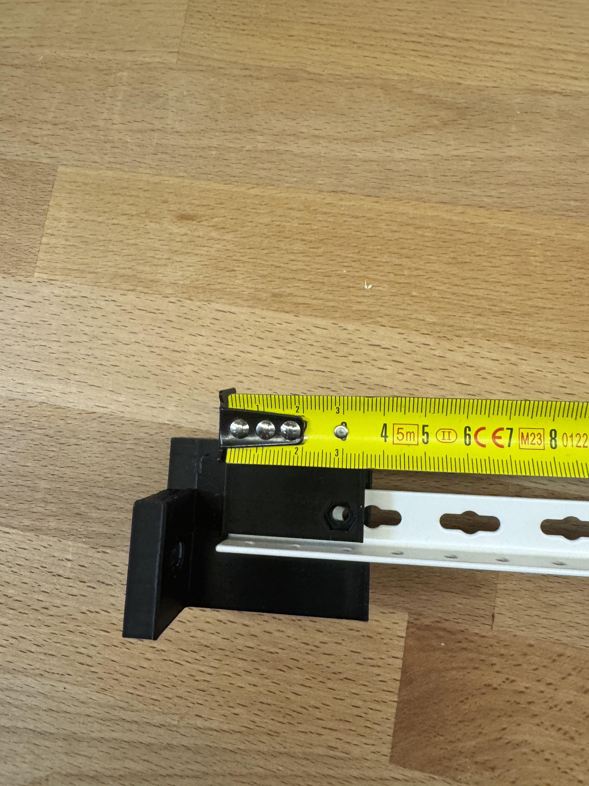
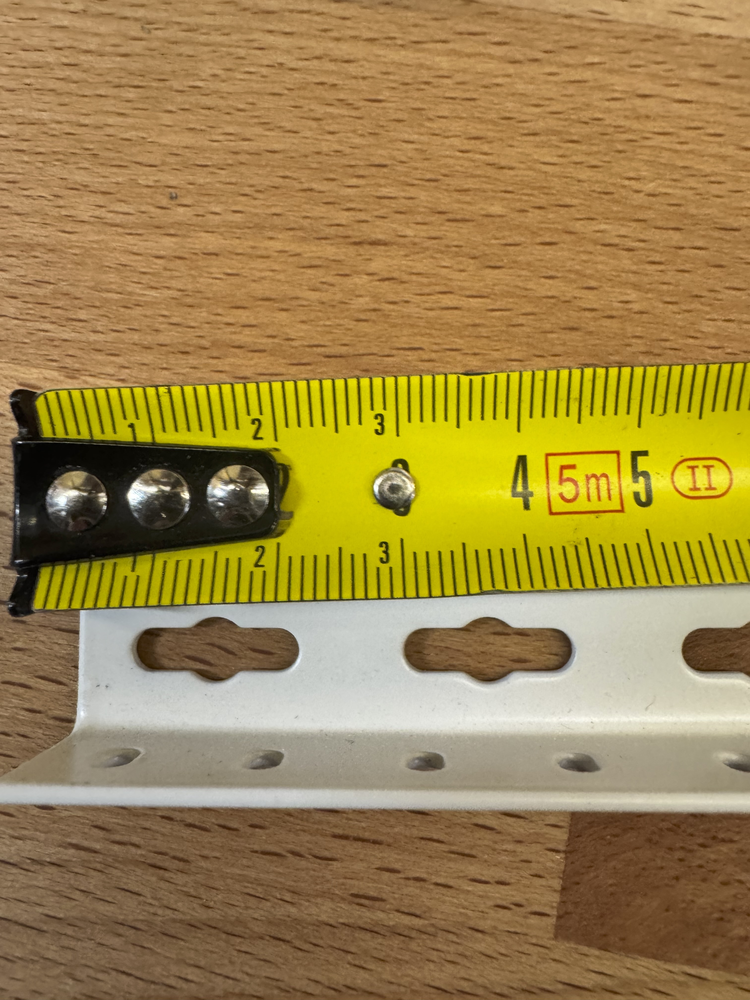
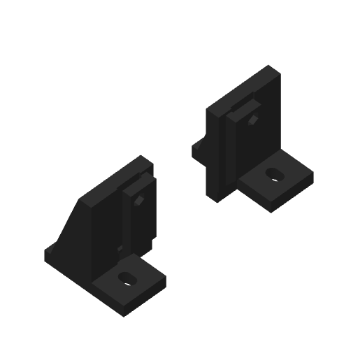

[Read in English](../en/rails.md)

# Rails en L et verrouillage arrière — R3

Les rails achetés portent le marquage **15,5 × 15,5 × 1,5 mm**. L’aile horizontale porte le poids ; les berceaux imprimés soutiennent les deux extrémités. Le propriétaire coupe les rails après présentation des berceaux : aucune profondeur de baie n’est imposée aux supports d’extrémité.

## Correction après essai physique

Le verrou R2 était à 30 mm du bout du rail. La pièce imprimée ne s’alignait pas sur le trou métallique. L’utilisateur a ensuite donné les centres à **15, 35 et 50 mm**. La R3 retient **35 mm** et prolonge tablette, nervures et gorge arrière de 5 mm, avec déplacement simultané du passage M4, du logement d’écrou et de l’accès inférieur.

Ces photos montrent la **R2 avant correction**, pas une R3 validée. Les vues du mètre servent de contexte ; la cote de 35 mm provient de la mesure déclarée par l’utilisateur. Géométrie et tranchage R3 sont contrôlés ; la confirmation physique reste attendue.

## Montage

1. Placer quatre berceaux à l’intérieur : derrière les montants avant et devant les montants arrière. Deux M6 par berceau, soit **huit au total**.
2. Vu de devant : AV-A = avant gauche, AV-B = avant droit ; AR-B = arrière gauche, AR-A = arrière droit. Tourner les arrière de 180° autour de la verticale pour orienter leurs gorges dans la baie.
3. Le montage M6 doit plaquer la platine PETG contre le montant. Un écrou cage coincé entre les deux empêche ce serrage ; choisir une position compatible de l’écrou sur la face opposée, avec rondelle et vis assez longue. Serrer les M6 avant d’insérer les rails.
4. Présenter et couper les rails entre les butées, puis ébavurer. Introduire l’arrière jusqu’à la butée, aile horizontale sous le toit de la gorge et aile verticale dégagée.
5. Aligner le trou existant à **35 mm du bout du rail**. Placer l’écrou M4 dans la poche supérieure et introduire la vis M4 × 20 par dessous. Elle traverse support, métal et toit de gorge. Ne pas forcer une vis désalignée ni repercer avant d’avoir identifié la bonne ouverture.
6. Serrer modérément. La vis empêche le retrait ; elle ne doit pas écraser le PETG pour supprimer le jeu de gorge. Contrôler la retenue du rail, les appuis du châssis et le dégagement au-dessus du verrou avant chargement.

| Caractéristique | R3 |
|---|---:|
| Axe M4 depuis le bout du rail | 35 mm |
| Butée depuis la face de fixation | 18 mm |
| Axe M4 depuis la face de fixation | 53 mm |
| Portée totale du support arrière | 61 mm |
| Longueur du toit de gorge | 41 mm |
| Hauteur du passage | 2,1 mm pour le métal nominal de 1,5 mm |
| Passage M4 | 4,3 mm |
| Écrou | 7,2 mm entre plats ; profondeur 3,4 mm |
| Axe depuis le bord extérieur de l’aile horizontale | 7,75 mm |

Le toit dépasse d’environ **6,6 mm au-dessus de la surface d’appui du rail**, plus l’éventuel dépassement de vis. Le placer hors de l’appui du châssis ou prévoir le dégagement correspondant. Aucune charge admissible de baie n’est établie.

Télécharger les [fichiers R3](files.md). Les supports avant restent identiques aux R1/R2 : seuls les arrière sont à réimprimer si les avant sont déjà disponibles.
