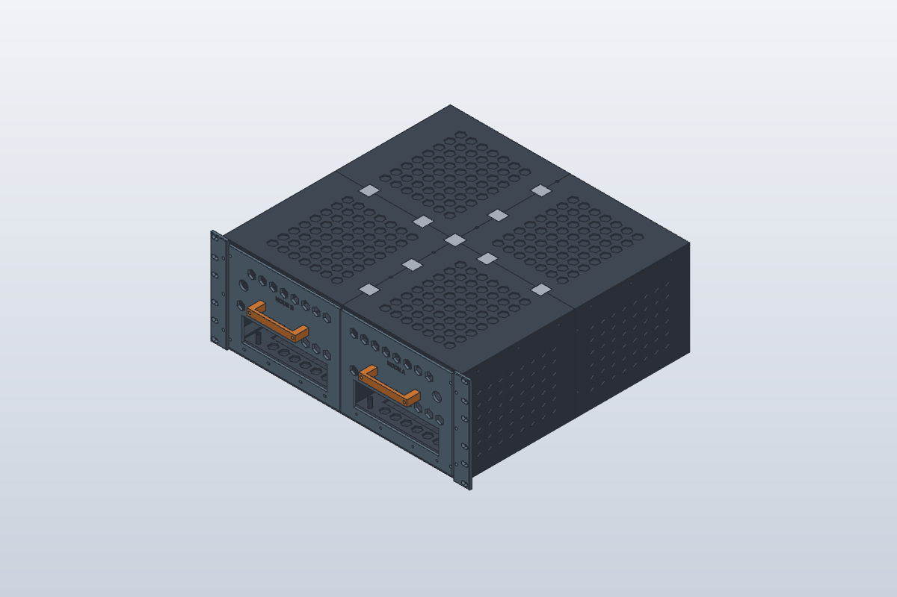
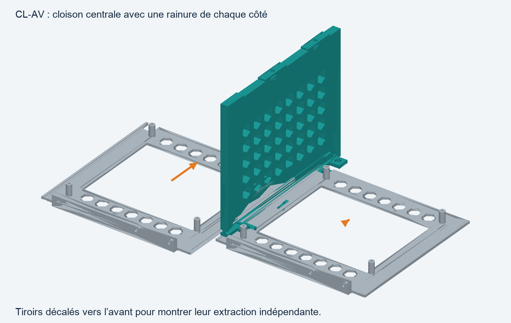
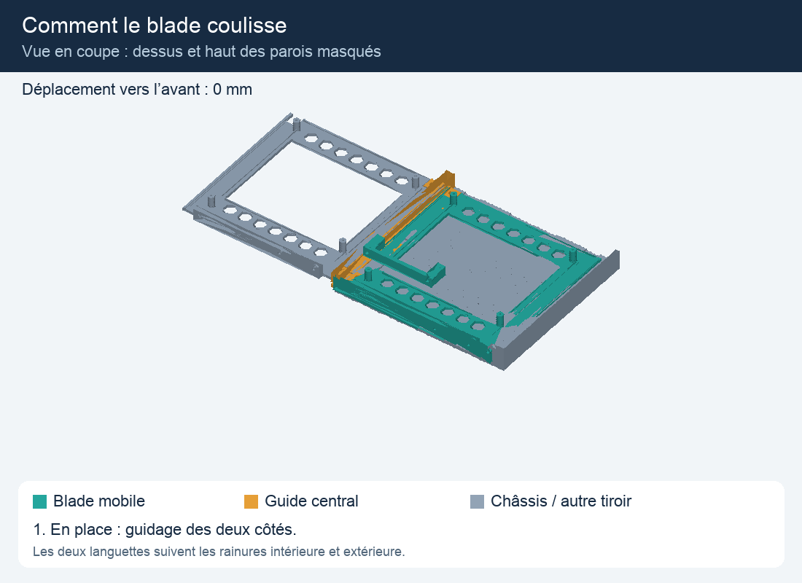
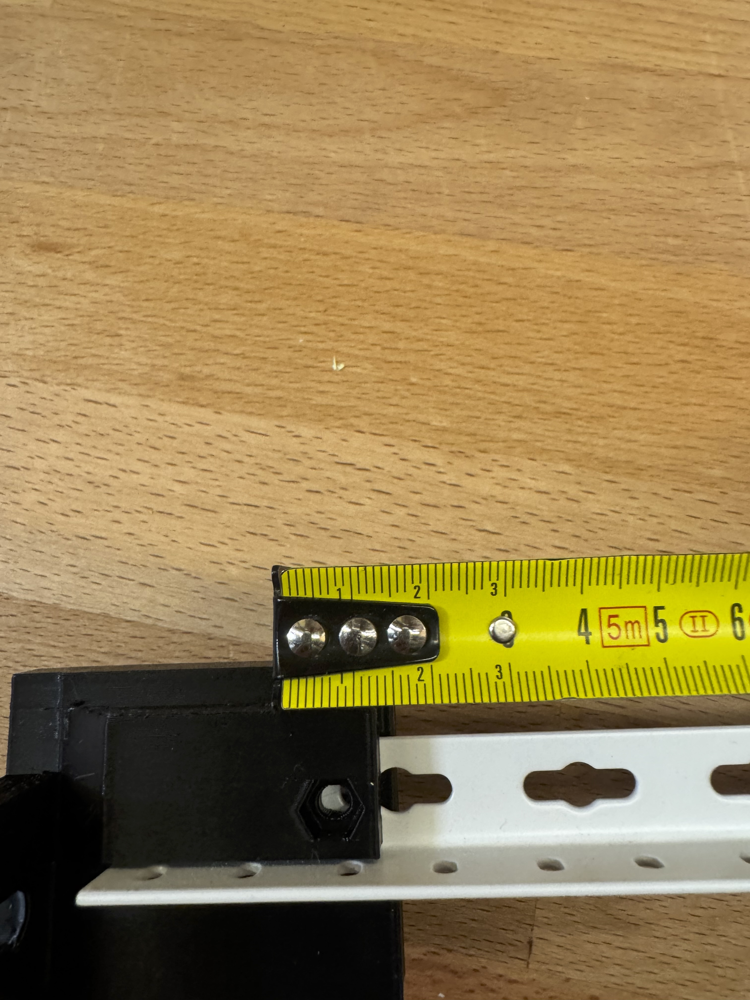

[Read in English](../en/timeline.md)

# Chronologie du développement

Les dates proviennent des commits CAO locaux et des notes de révision conservées. Il s’agit d’un journal synthétique, pas d’une transcription intégrale du chat. L’historique du dépôt d’origine n’est pas importé dans ce dépôt public.

| Date | Étape | Décision et résultat |
|---|---|---|
| 24 octobre 2026 | Modèle initial / R1 | Structure 19 pouces 4U en quatre quadrants ; deux plateaux de carte, alimentations ATX et ventilateurs 120 mm ; natif, STEP et 3MF |
| 25 octobre 2026 | Correction du flux / travaux R2–R3 | Conserver l’allègement hexagonal avec un fond de 1 mm ; aspiration avant et sortie arrière |
| 25 octobre 2026 | Planche de tolérances | Éprouvettes PETG pour biscuits, passages de vis et écrous captifs |
| 25 octobre 2026 | Coin avant intégré | Intégration Q-AV-G + EAR-G pour réduire les pièces séparées |
| 25 octobre 2026 | Guidage / R4 | Consolidation du modèle complet et explication des guides centraux et du coulissement |
| 25 octobre 2026 | V5 | Extraction du node entier : façade, plateau, ventilateur, PSU et panneau arrière ; câbles externes débranchés |
| 25 octobre 2026 | V6 | Quatre tunnels imprimés verticalement, avec toits et demi-cloisons intégrés |
| 25 octobre 2026 | V7 | Remplacement des éclisses vissées par des murets de 60 mm à doigts verrouillés par filament |
| 25 octobre 2026 | V7 calibrée | Application des ajustements mesurés ; dix plateaux de production et un plateau d’éprouvettes optionnel |
| 26 octobre 2026 | Rails R1 | Quatre berceaux PETG pour deux cornières ; huit fixations M6 |
| 26 octobre 2026 | Rails R2 | Gorge arrière, M4 par dessous et écrou captif au-dessus ; axe nominal à 30 mm du bout du rail |
| 26 octobre 2026 | Rails R3 | Désalignement constaté ; centres donnés à 15/35/50 mm ; prolongement de 5 mm et utilisation du trou à 35 mm |

## Des plateaux séparés aux cassettes complètes

L’animation initiale explique le mouvement. Elle précède la refonte en cassette complète ; elle ne définit ni le démontage V7 ni sa validation de dégagement.

## De nombreuses fixations aux pièces intégrées

Le principe de jonction s’inspire de la [référence ALCH Modubox](https://www.alch.shop/modubox-alex/p/modubox-ikea-alex-drawer-organizer) et de la [vidéo à 8:31](https://youtu.be/VcB30EIcUMY?t=511) fournies par l’utilisateur. La géométrie du projet est originale ; aucun modèle commercial n’est redistribué. Une photo de châssis Dell a servi de référence conceptuelle pour le châssis vide ; cette photo tierce n’est pas incluse.

## Le retour physique corrige le modèle

L’essai non concluant est conservé comme preuve. La première réponse considérait à tort la cote nominale de 30 mm comme suffisante ; l’essai physique et la cote de 35 mm ont conduit à la R3. Aucun résultat de montage physique réussi de la R3 n’est encore enregistré.
